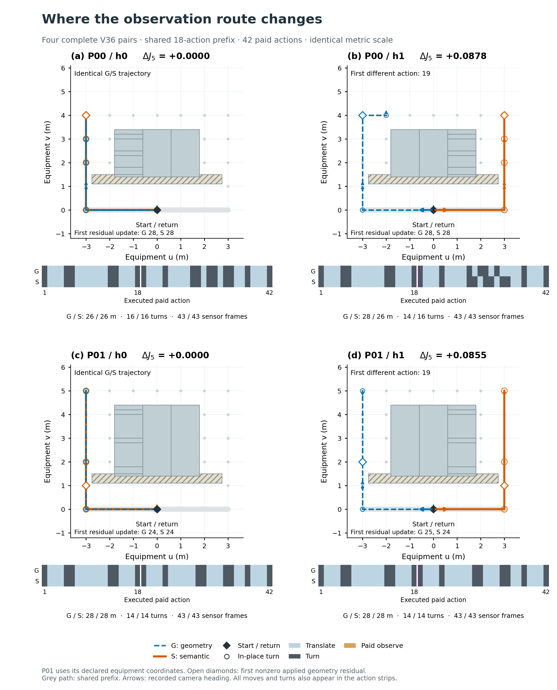
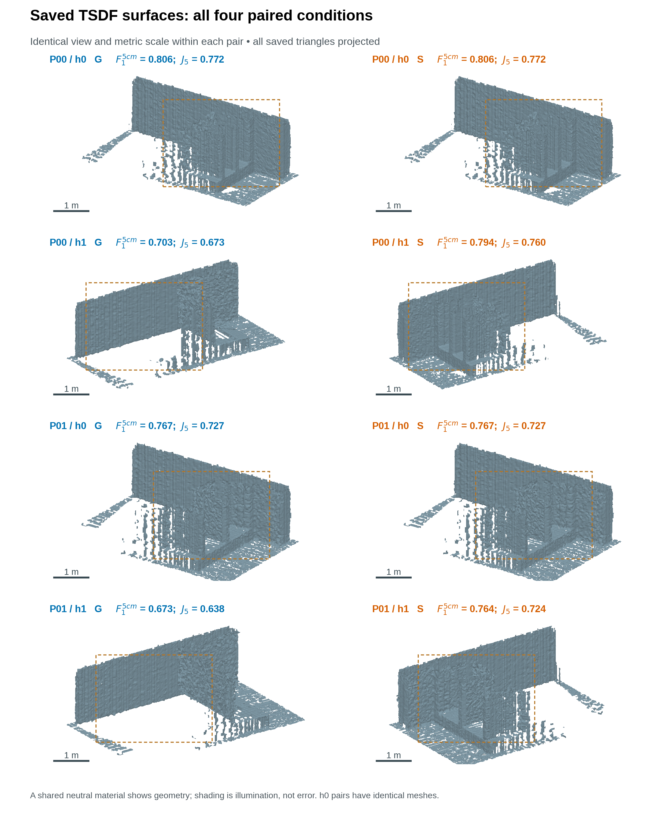
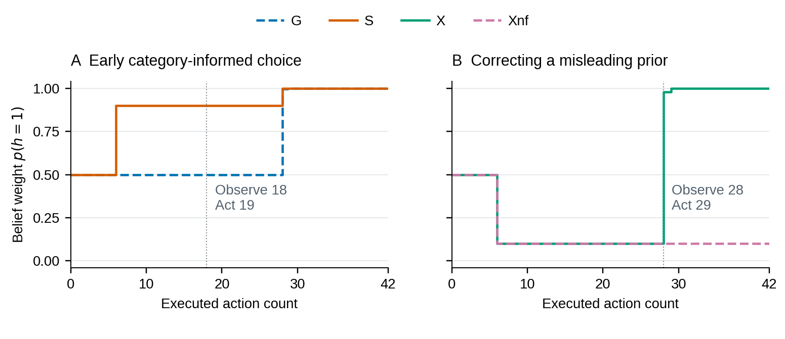
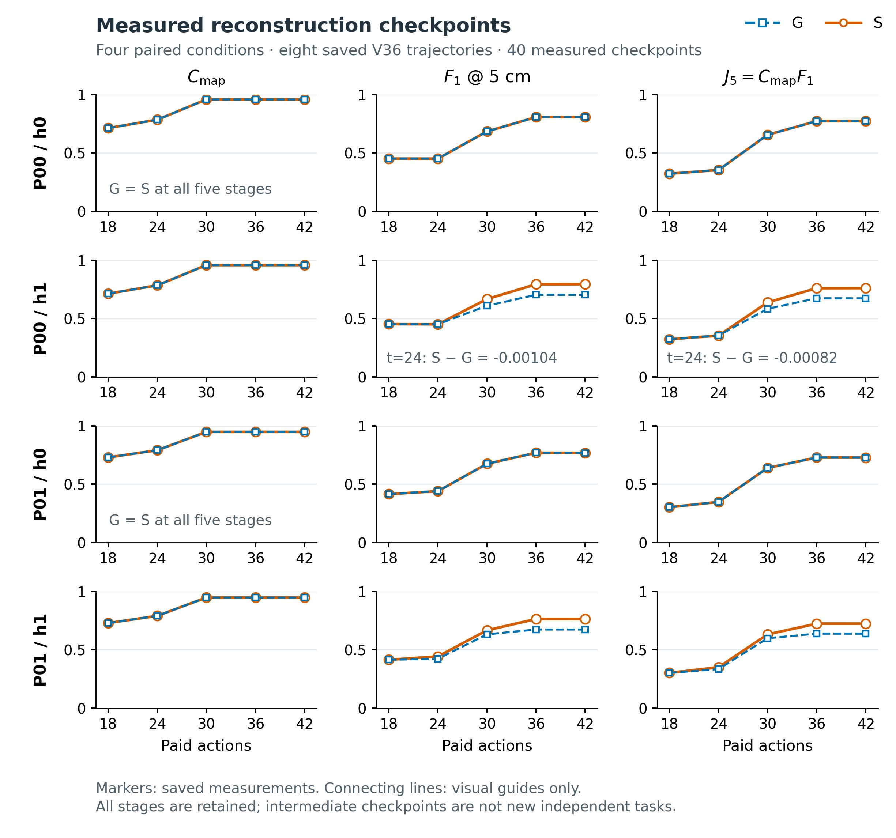
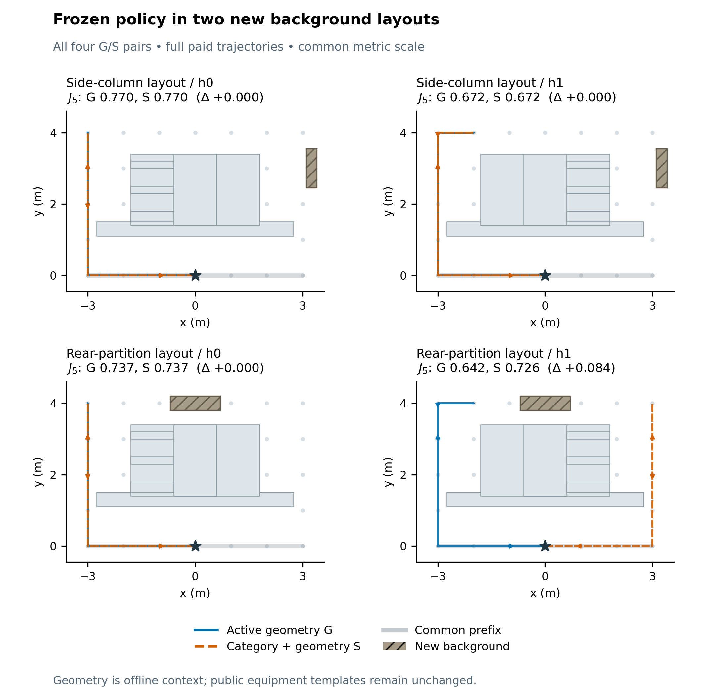
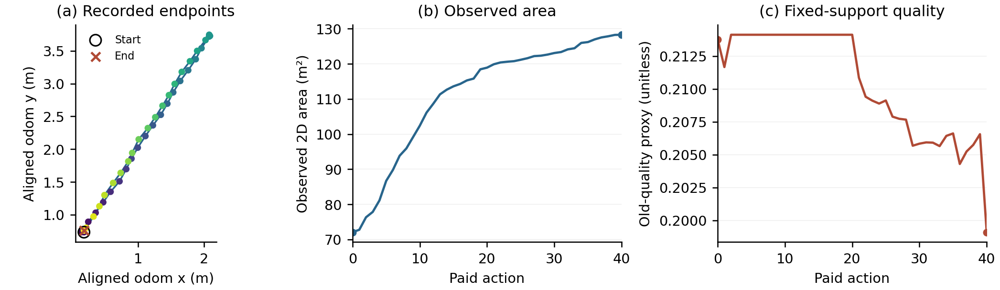
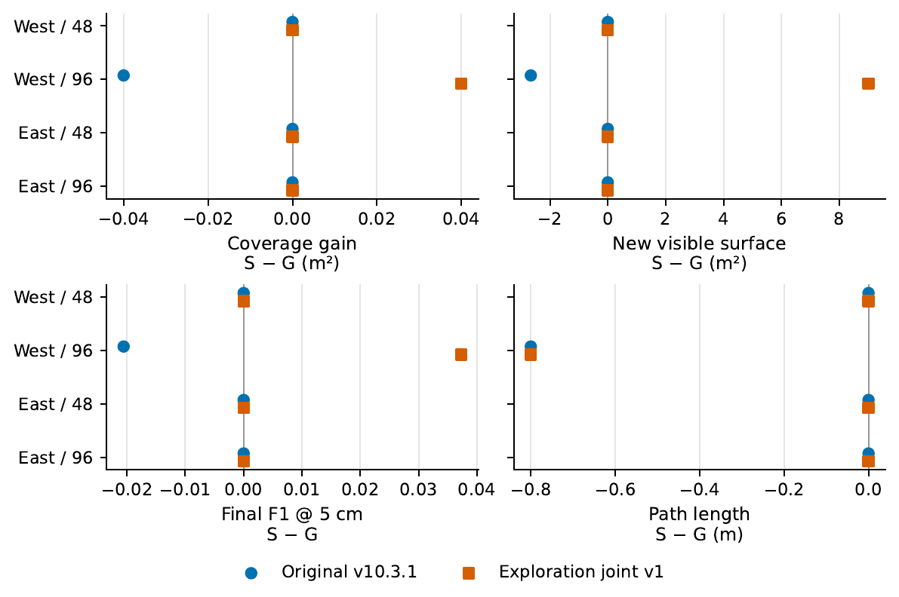
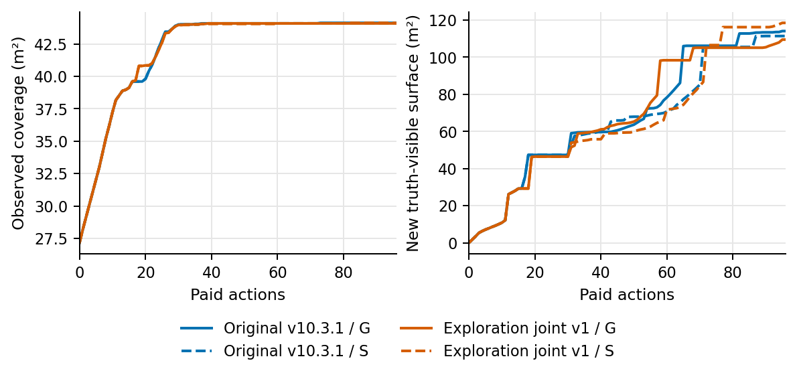
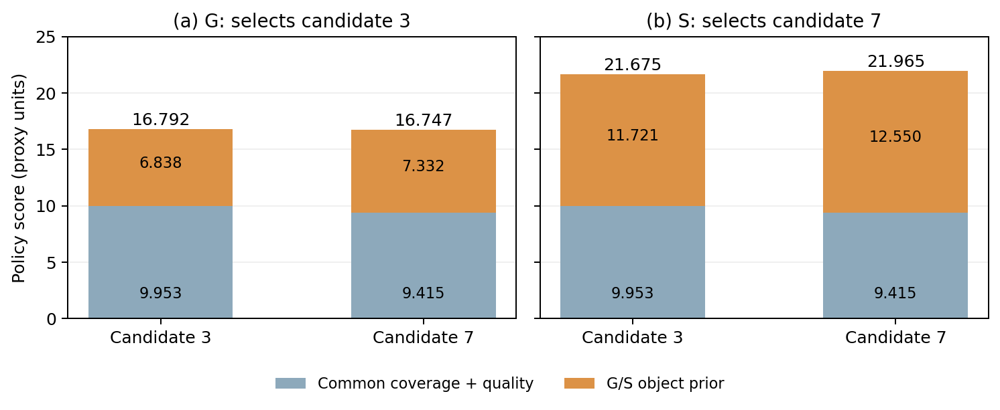

Skill-guided research revision, 29 October 2026; not submitted. The research-paper-writing workflow was applied to structure, terminology, claim support, and visual readability. Experimental records are unchanged.

# Correctable Category Priors for Budget-Constrained Active Observation

## Abstract

Recovering occluded facility surfaces under a fixed observation budget requires choosing where to look before geometry fully resolves the object's configuration. An early category cue can guide that choice, but a misleading cue can also waste the remaining budget. We study a correctable category-conditioned policy that combines bounded geometric evidence, diagnostic lookahead, and return-feasible planning. Its central principle is to use category information to rank sensing actions while restricting surface reconstruction to acquired depth. A matched geometry-only control retains the same planner, diagnostic opportunities, graph, and fusion backend. Controlled RGB-D simulations use two public configuration templates, exact poses, and synthetic category cues. Across four reference configuration pairs, the policy yields two improvements and two ties, increasing mean coverage–surface quality by 6.16% at unchanged planar coverage. Two changed-background layouts yield one improvement and three ties, with a 2.98% mean gain. A 128-attempt extension exposes 32 low-budget planning failures and a 0.70% larger-budget reversal. Recorded decisions show that the cue matters when it changes a consequential route ranking; stronger category support alone need not improve reconstruction. A separately declared joint-exploration deployment variant with a natural semantic frontend completes a bounded physical sensing–navigation–return loop. Matched semantic benefit, comparative coverage efficiency and real reconstruction accuracy remain unverified. These results characterize the conditions and limits of category-informed observation allocation.

**Keywords:** active observation; facility documentation; category priors; geometric feedback; budget-constrained reconstruction

## 1 Introduction

Budget-constrained active observation seeks sensing routes that recover accessible space and equipment surfaces while preserving enough resources to return to the start. Maintaining current spatial records is important when industrial workspaces are reconfigured [9]. For this task, broad floor coverage can coexist with missing equipment faces: a robot may observe a corridor while leaving a recessed opening or the far side of a cabinet unseen. Useful observation directions therefore matter alongside the amount of space traversed.

The central decision is which viewing direction to choose before acquired geometry resolves the equipment configuration. Active mapping and reconstruction planning can seek diagnostic viewpoints [10], but obtaining that information consumes part of the same budget needed to inspect surfaces and return. A category associated with a particular opening or service side can supply an earlier preference. The benefit depends on whether that preference changes an affordable, consequential route; an incorrect cue must remain revisable when geometric evidence contradicts it.

We study a category-conditioned observation policy that connects configuration belief, diagnostic lookahead, and return-constrained execution. A finite category prior weights two public configuration hypotheses. The planner evaluates future exposure and a possible diagnostic observation, executes one feasible action, and replans after bounded residual evidence updates the belief. Acquired depth is fused separately into the measured reconstruction. Thus, the same configuration hypotheses guide where to sense without supplying unobserved surfaces to the reconstructed output.

This formulation makes the value of a category cue testable against an active geometric alternative. Both policies retain the same graph, templates, diagnostic opportunities, action budget, and reconstruction backend; only the category support differs. A two-configuration analysis relates the value of immediate route selection to the cost and reliability of geometric diagnosis. Recorded beliefs and actions then connect that decision-level account to measured endpoint quality, separating a changed internal score from an actual change in observation allocation.

Controlled simulations yield two improvements and two ties across four reference configuration pairs, increasing mean joint coverage–surface quality by 6.16% at unchanged coverage. Two additional background layouts yield one improvement and three ties, with a 2.98% mean gain. The 128-attempt budget/geometry extension also retains 32 planning failures and a 0.70% larger-budget reversal. These outcomes bound the mechanism's benefit. A separately declared joint-exploration deployment variant with a natural semantic frontend completes a bounded physical sensing–navigation–return loop. Matched semantic benefit, comparative coverage efficiency and real reconstruction accuracy remain unverified, and the deployment is not equivalent to the controlled V35 policy.

The contributions are:

1. A task-specific observation formulation couples correctable category support, diagnostic lookahead, and a return budget, with an explicit separation between public planning hypotheses and measured reconstruction.
2. A two-configuration decision analysis and recorded belief–action traces explain when an early cue changes a useful route and when geometric diagnosis can remove its advantage.
3. A matched evaluation connects information changes to complete routes and measured surfaces, reporting all paired outcomes and feasibility failures; a separate physical case study identifies the remaining deployment gap.

## 2 Related Work

### 2.1 Active mapping and hierarchical exploration

Active mapping chooses motion to improve an environmental representation while accounting for state estimation [10]. TARE coordinates local and global exploration at different resolutions [5], and Active Neural SLAM uses a learned hierarchy to separate strategic decisions from execution [1]. We use this separation to study observation allocation under a return budget. Exact poses and a shared safe graph hold navigation resources fixed so that the controlled comparison concerns the value of category information.

### 2.2 Reconstruction-driven view planning

Reconstruction-driven view planning seeks observations that improve surface recovery. GenNBV learns a next-best-view policy from geometric, semantic, and action representations in a five-dimensional viewpoint space [6]. Our planner evaluates explicit configuration hypotheses on a discrete ground-motion graph. It uses predicted exposure to rank observations, while the measured output is reconstructed using Open3D [4] and volumetric range integration [11]. This design enables a direct comparison of early category information under common motion and fusion resources; generalization to the broader view-planning settings studied by learned policies remains untested.

### 2.3 Semantic information for observation planning

Semantic inspection links target meaning with sensing requirements. SWAP combines exploration, semantic completion, and surface inspection [2]; predictive inspection planning uses repeated semantic scene-graph structures to anticipate unseen targets [7]. VISTA couples task relevance with directional coverage in online semantic Gaussian mapping [3], and ActiveSGM combines semantic and geometric uncertainty to estimate observation informativeness [8]. Here, category information weights alternative hidden configurations of one facility, and contrary acquired geometry can revise those weights before the next return-feasible route is selected. Belief-based planning and robotic information gathering provide the decision-theoretic foundations [12,13].

Our main category comparison uses matched internal policies so that the information source is the controlled difference. SWAP-I and VISTA-I adapt selected planning mechanisms to the common sensing and fusion setting, and native TARE runs in a simulated sensing and mapping loop provide additional integration evidence. Their changed representations, objectives, and execution interfaces make them complementary mechanism comparisons rather than a ranking of the original complete systems.

## 3 Problem Formulation

Each acquisition task takes place in a static environment; changes occur between tasks. The local inspection target is one equipment-scale facility with an unknown configuration \(h\in\{0,1\}\). Both policies receive two public templates, a facility coordinate frame, an initial pose \(s_0\), and a safe pose graph. They receive RGB-D, planar scan, and pose observations only when those observations are acquired. The category–configuration association is manually specified public knowledge. Evaluation references, true configuration identifiers, and actual measurements from unexecuted actions are unavailable to the planner.

A forward motion of 1 m or a 90° turn consumes one action and acquires a sensor frame. An identical 18-action observation prefix precedes autonomous selection within total budget \(B\). The original confirmation uses \(B=42\); the extension also evaluates 30 and 54. A qualified task must remain collision-free, finish within budget, attain at least 80% planar coverage, and return to the initial position and orientation. The experiment consequently tests allocation after common observation, rather than unknown-environment exploration from the first action.

The principal measured score combines planar coverage and surface quality:

\[
C_{\rm map}=\frac{|\{c\in\mathcal R:m_T(c)\ne-1\}|}{|\mathcal R|},
\qquad F_{1,\tau}=\frac{2P_\tau R_\tau}{P_\tau+R_\tau},
\qquad J_5=C_{\rm map}F_{1,0.05}.
\]

Here \(\mathcal R\) is the start-reachable evaluation grid, \(m_T\) is the terminal measured occupancy map, and \(-1\) denotes an unobserved cell. \(P_\tau\) and \(R_\tau\) denote surface precision and recall within distance \(\tau\), measured in meters. Section 5.1 specifies the evaluation region, sampling, and qualification rules.

The desired policy maximizes expected measured \(J_5\) using acquired information while respecting budget and return constraints. Online template exposure is only its planning surrogate. A larger predicted opportunity need not produce a more accurate fused mesh, and additional observations do not guarantee improvement at every surface threshold.

## 4 Observation Planning with Correctable Category Priors

### 4.1 System overview and planning state

The NSO research prototype selects observation actions using a configuration belief and the budget required to return. Figure 1 separates four functions: category support supplies an initial preference, geometric correction revises it, diagnostic planning evaluates feasible continuations, and a return-feasibility check admits the next action (Table 1). Each executed action acquires a new measurement for replanning and measured reconstruction. The category-conditioned policy S and geometric control G share the graph, public templates, diagnostic planning, and fusion backend; only S receives the category prior. Section 5.7 distinguishes the effects supported by these controls.

**Table 1. Functional components and their roles in the observation loop.**

| Function | Input | Output and role |
|---|---|---|
| Category support | Acquired RGB, pose, measured-map summary | Register category support and configuration prior |
| Diagnostic planning | Graph, exposure sets, beliefs, remaining budget | Compare feasible continuations and select a subgoal |
| Return-feasibility check | Proposed edge, budget, return distance | Permit or reject the executable action |
| Geometric correction | Acquired depth/scan and public predictions | Bound geometric evidence and revise belief |


**Figure 1.** Information flow and execution boundary. Category support and acquired geometric evidence update a configuration belief; the planner selects a feasible observation action. Acquired depth separately updates the measured reconstruction. Public predictions score candidate actions and never become fused measurements. The robot interface is an integration path whose current evidence is reported separately in Section 6. [PDF](figures/skill_revision_20261029/system_architecture.pdf).

After action \(t\), the planning state is

\[
x_t=(s_t,b_t,M_{0,t},M_{1,t},p_t,\mathcal V_t),\qquad b_t=B-t.
\]

Here \(s_t\) includes position and heading, \(p_t\) weights configuration 0, and \(\mathcal V_t\) contains measured poses. Each \(M_{h,t}\) records the union of floor samples and surface patches predicted visible from previously observed poses under public template \(h\). These exposure sets support prospective planning; the measured map separately integrates acquired depth. Neither hidden configuration identifiers nor evaluation surfaces enter the state. The common 18-action prefix updates observations and returns to \(s_0\); subsequent actions depend on the resulting belief.

Both hypotheses remain available throughout execution. Category information changes their weights rather than selecting a template as reconstructed truth. The online belief module additionally retains geometric log-support and category-registration history, while each planning call receives their current combined weight. This separates two questions: which configuration the acquired evidence supports, and which affordable observation sequence is valuable under that uncertainty.

### 4.2 Category support and geometric correction

A category cue must influence early decisions without preventing later contradictory measurements from changing the route. We therefore register finite category support once and combine it with bounded evidence from newly acquired viewpoints. This design allows a cue to establish a preference while preserving both configuration hypotheses.

The category-support function registers a category when its marker occupies at least 16 exact-color pixels at each of two distinct XY positions, without a competing marker in those frames. Registration supplies \(L_t^s=\pm\log9\); repeated detections do not multiply this prior, and conflicting category support clears it. G uses \(L_t^s=0\). Synthetic markers provide a controlled category channel, independently of natural-image recognition performance.

Geometric correction compares acquired depth and scan measurements with both public predictions. Let \(e_{h,t}^{k}\) be the mean residual loss for eligible modality \(k\) under template \(h\), and \(\mathcal K_t\) its valid-modality set. At a newly visited pose,

\[
\begin{aligned}
\delta_t=\operatorname{clip}_{[-6,6]}
\left(\frac{1}{|\mathcal K_t|}\sum_{k\in\mathcal K_t}
\bigl(e_{1,t}^{k}-e_{0,t}^{k}\bigr)\right),\\
L_t^g=\operatorname{clip}_{[-24,24]}(L_{t-1}^g+\delta_t),\qquad
p_t=\sigma(L_t^g+L_t^s).
\end{aligned}
\]

Here \(\sigma(z)=(1+e^{-z})^{-1}\). The increment is zero when no modality qualifies or the pose has already supplied evidence. Residuals use samples where public predictions differ by more than \(10^{-5}\) m. Depth requires eight valid pixels and normalized disparity residual \((57.6/z-57.6/\widehat z_h)/0.25\); scan requires three valid beams and residual \((r-\widehat r_h)/0.02\). Each sample contributes half its squared residual, capped at 12.5. Missing measured returns are ignored; a missing predicted depth return receives the capped loss. Eligible modality means receive equal weight.

These bounded pseudo-likelihoods prevent individual extreme residuals from dominating. They are not calibrated probabilities, and excluding exact repeats does not establish independence between neighboring views. New depth from a repeated pose still contributes to fusion. An incorrect prior remains correctable: for \(L^s>0\), configuration-1 support reaches \(\eta>1/2\) whenever

\[
L_t^g\le-L^s-\operatorname{logit}(\eta).
\]

This threshold is attainable only if sufficient contrary observations occur and the cumulative cap permits it. The finite prior therefore expresses a revisable preference rather than a permanent semantic constraint.

### 4.3 Predictive value and diagnostic lookahead

A diagnostic view can be valuable because it changes a later route choice, even when its immediate predicted surface gain is small. The planner therefore evaluates future exposure under both configurations and includes one possible diagnostic event within each planning call. Its predicted exposure score guides sensing, while the endpoint score remains a measurement of the reconstructed surface.

For template \(h\), let \(\mathcal F_h\) contain its floor samples, \(\mathcal P_h\) its exterior vertical patches, \(a_u\) the patch area, and \(A_h\) the total exterior vertical area. Writing \(M_h^f\) and \(M_h^s\) for the corresponding exposed subsets gives

\[
\widetilde C_h=\frac{|M_h^f|}{|\mathcal F_h|},\qquad
\widetilde S_h=\min\left(1,\frac{\sum_{u\in M_h^s}a_u}{A_h}\right),\qquad
\widetilde J_h=\widetilde C_h\widetilde S_h.
\]

Thus \(\widetilde S_h\) is an exposed-area fraction, not reconstructed surface F1. The surrogate rewards opportunities to observe missing surfaces but does not model TSDF error or improvements from repeated measurements. Its relation to measured \(J_5\) is tested empirically.

Exposure is accumulated by set union, so viewing an already exposed patch supplies no additional proxy area. Changing direction can still reveal previously occluded patches. Floor samples are those declared by the public planning model, distinct from the finer reachable-cell grid used to measure \(C_{\rm map}\). Consequently, neither component of the surrogate is substituted for an endpoint measurement. Keeping both representations makes the planning assumption explicit: access to additional surface area is a useful, imperfect predictor of reconstructed quality.

Let \(M=(M_0,M_1)\). Stopping requires the complete initial pose and adequate predicted floor exposure under both configurations:

\[
Z(s,M,p)=
\begin{cases}
p\widetilde J_0(M_0)+(1-p)\widetilde J_1(M_1),
&s=s_0,\ \min_h\widetilde C_h(M_h)\ge0.8,\\
-\infty,&\text{otherwise}.
\end{cases}
\]

Diagnostic planning approximates belief-space planning [12,13] with one future diagnostic event per planning call. Diagnostic candidates are determined from public sensor predictions: treating each template prediction as a hypothetical observation must yield geometric evidence at least \(+\log99\) for configuration 0 and at most \(-\log99\) for configuration 1. Previously measured poses are excluded. This identifies potentially discriminative viewpoints without obtaining their actual observations.

For an anticipated diagnosis of assumed accuracy \(r_d=0.99\), the branch weights and updated planning beliefs are

\[
\begin{aligned}
\lambda_0&=pr_d+(1-p)(1-r_d),\qquad \lambda_1=1-\lambda_0,\\
p^{(0)}&=\frac{pr_d}{\lambda_0},\qquad
p^{(1)}=\frac{p(1-r_d)}{\lambda_1}.
\end{aligned}
\]

Let \(q\in\{0,1\}\) indicate whether this event remains available. Action \(a\) reaches \(s'\), consumes one action, and updates \(M'_h=M_h\cup E_h(s')\), where \(E_h\) is public predicted exposure. The continuation and value recursions are

\[
Q_q(a)=
\begin{cases}
\sum_{y=0}^{1}\lambda_y V_0(s',b-1,M',p^{(y)}),
&q=1,\ s'\text{ diagnostic},\\
V_q(s',b-1,M',p),&\text{otherwise},
\end{cases}
\]
\[
V_q(s,b,M,p)=\max\left\{Z(s,M,p),\max_{a\in\mathcal A(s)}Q_q(a)\right\}.
\]

At \(b=0\), only stopping is available. States whose return distance exceeds \(b\) are infeasible, as are diagnostic actions with either infeasible branch. Forecast beliefs remain inside the current calculation. The controller executes only the first selected action, updates belief from acquired measurements, and replans. The category strength 0.9 and forecast accuracy 0.99 are fixed design settings shared across the comparisons, rather than measured classifier or sensor accuracies.

The recursion evaluates complete remaining continuations, rather than immediately visible area alone. Anticipated diagnosis is useful only through the different actions it may enable afterward. Requiring a feasible continuation in both branches prevents a low-weight configuration from being silently discarded to satisfy the return and coverage gates. The approximation limits the number of belief changes within one forecast; it does not limit the number of measured corrections over the executed trajectory. A later call can anticipate another diagnostic event after assimilating the latest frame.

### 4.4 Budgeted execution and reconstruction

An informative view is useful only if the robot can execute it and still return within budget. The execution layer reserves the shortest graph return cost before each action; the reconstruction layer then integrates only the depth acquired at the executed pose.

The return-feasibility check accepts a legal edge only if

\[
1+d_{\rm return}(s')\le b_t,
\]

where return distance includes restoration of the starting heading. On the fixed graph with unit action costs, this preserves an affordable return path: after each accepted action, \(d_{\rm return}(s_{t+1})\le b_t-1=b_{t+1}\). This certificate concerns graph feasibility; task qualification additionally requires measured coverage, collision-free execution, and actual return.

**Algorithm 1. Category-conditioned receding-horizon observation.**

```text
Input: common graph, templates, budget B, prefix, policy G or S
Initialize belief support, exposures, and visited poses
Repeat:
  Read the initial frame or latest executed-action frame
  Fuse acquired depth exactly once into the measured TSDF
  Register category support and update geometric evidence
  Add current template exposures and record the measured pose
  If collision or budget exhaustion: record termination; exit
  If the shared prefix is unfinished: select its next action
  Otherwise:
    Exclude measured poses from diagnostic candidates
    Solve V1 from the current state and remaining budget
    If infeasible or a resource cap is exceeded: fail; exit
    If stopping is optimal within tolerance: stop; exit
    Select the first maximizing action in fixed graph-edge order
  Check graph legality and the return-budget inequality
  If rejected: record the termination reason; exit
  Execute one action, charge its cost, and obtain the next frame
Output: measured map, trajectory, observations, and stop reason
```

Equal-valued choices use a \(10^{-12}\) tolerance and fixed edge order. The shared Open3D CPU TSDF [4,11] uses 4 cm voxels and 12 cm truncation; public templates never contribute synthetic depth. Outputs precede independent endpoint evaluation. Incorrect-prior controls exchange category interpretation; the no-correction variant additionally disables measured correction and forecast diagnosis.

For \(N\) poses and exposure bitset lengths \(m_0,m_1\), the cached state count is conservatively bounded by \(K\le3N(B+1)2^{m_0+m_1}\), covering the initial and two post-diagnosis weights. With maximum out-degree \(d\), bitset-update cost \(T_m\), and terminal-evaluation cost \(T_z\), planning costs \(O(K(dT_m+T_z))\), excluding return-distance preprocessing. Each call permits 1.5 million cached states and approximately 20 s; elapsed time is checked every 1024 new states and at selection completion. This finite implementation supports the controlled task, with exponential exposure-state dependence.

### 4.5 Decision interpretation and conditions for benefit

A recorded example connects the recursion to robot behavior. After the common prefix in P00, G assigns both configurations weight 0.5; left/right continuation values of 0.650944 tie. With configuration-1 category support 0.9, S obtains 0.668008/0.711865 and turns right at action 19. A misleading prior can subsequently reverse: geometric evidence of \(-6\) at step 28 gives configuration-1 weight \(1-\sigma(-6+\log9)=0.978178\), followed by a changed action at step 29. These are planning values and belief weights; measured reconstruction outcomes are reported separately.

The underlying tradeoff can be expressed using established belief-based decision principles [12,13]. Assume two initially equally likely configurations, two return-feasible routes, matched utility \(U_+\), mismatched utility \(U_-\), and \(\Delta=U_+-U_->0\). A category cue has symmetric reliability \(r_c\ge1/2\). Optional geometric diagnosis has symmetric reliability \(r_d\ge1/2\), is conditionally independent given configuration, and costs utility \(\kappa\). Both routes remain feasible afterward. For current belief \(p\), direct choice succeeds with probability \(m=\max(p,1-p)\); optimal choice after diagnosis succeeds with probability \(\max(m,r_d)\). Its net value is

\[
\Delta\max(0,r_d-m)-\kappa.
\]

G benefits from diagnosis when \(\kappa<(r_d-1/2)\Delta\), whereas a category-conditioned decision requires \(\kappa<(r_d-r_c)_+\Delta\), with \(\kappa\ge0\). An informative cue can therefore avoid a diagnostic detour while preserving a useful observation direction. Its benefit disappears when geometry already resolves the choice or route utilities coincide. When \(r_d\ge r_c\) and diagnosis is free, both policies can attain the same expected directional utility; a free but less reliable diagnosis need not remove the category advantage. These analytical reliabilities are assumptions distinct from implementation settings. The argument identifies conditions for improved allocation; it does not guarantee better measured reconstruction under the exposure surrogate.

The practical consequence is a conditional experimental prediction: a category cue should matter when it changes a consequential route ranking before equivalent geometric evidence is affordable. If geometry and category already favor the same route, identical actions and quality are expected. Tests therefore examine action changes, acquired surfaces, and measured quality together, rather than interpreting stronger belief alone as a mapping improvement.

## 5 Experiments and Results

The experiments test four questions. RQ1 asks whether category information improves measured surface recovery at matched coverage (Section 5.2). RQ2 asks whether acquired geometry can correct a misleading cue and how changed decisions affect reconstruction progress (Section 5.3). RQ3 compares observation allocation under common-CPU planning mechanisms (Section 5.4). RQ4 tests sensitivity to budget, geometry, and background layout (Sections 5.5–5.6). Section 5.7 assesses component attribution, and Section 6 reports physical integration separately.

### 5.1 Experimental setup and matched comparisons

The simulator supplies 96×72 depth images over a 4 m range and a 360° planar scan with 180 beams over 8 m. Poses are exact. Depth noise has a standard deviation of 0.25 pixels in reference disparity; no additional random scan noise is applied. The experiments isolate planning under controlled observations rather than reproduce physical sensor errors.

The evaluator derives the start-reachable safe-cell set \(\mathcal R\) using a 0.2 m grid and 0.2 m robot radius. It contains 588 cells in P00 and 668 in P01. A nonunknown cell counts as observed, including one marked occupied, so coverage is not occupancy-classification accuracy. Ground truth is used after prediction sealing, not to supply runtime measurements.

Surface precision and recall follow distance-threshold comparison [14]. Precision queries the reference from sampled predicted surfaces; recall queries the prediction from fixed exterior vertical reference surfaces. The prediction is cropped to the common bounding box of both templates with a 0.20 m margin, and the known ground is removed. Thus, errors outside this region do not enter precision. No registration or hole filling is applied. Thresholds are fixed at 2, 5, and 10 cm, with 5 cm primary; empty predictions receive zero quality. Coverage, precision, recall, and task qualification accompany the product to avoid hiding its components.

Confirmation freezes the controller and uses a held-out noise seed on two previously seen parent layouts, each with two configurations: eight runs and four G/S pairs. The layout-level units are the two parent layouts. Two configurations per layout and repeated noise realizations are paired conditions, not independent evidence of category-level generalization. The policies differ as follows: G has no category support; S uses the designated correct cue; X reverses the category interpretation; and Xnf uses the same reversed interpretation while disabling measured correction and future diagnostic anticipation. The development X/Xnf contrast therefore evaluates the bundled correction policy. Replays and alternative thresholds reuse these trajectories; they do not increase the number of independent layouts or trials. The principal G control retains the diagnostic views and revisiting available to S; Xnf deliberately disables measured correction and anticipated diagnosis.

For each matched condition we report the absolute score difference, \(\Delta J_5=J_{5,S}-J_{5,G}\). A relative mean change is \(100(\overline J_{5,S}/\overline J_{5,G}-1)\), rather than an average of per-condition percentages. Qualification is reported over all declared attempts; endpoint means include only the explicitly qualified groups.

The recorded software is Python 3.12.3, NumPy 1.26.4, SciPy 1.11.4, and Open3D 0.19.0, with one OpenMP, OpenBLAS, and MKL thread. No GPU is required. Figures use actual recorded actions and measured meshes except the explicitly schematic architecture diagram.



**Figure 2.** Both configurations of P00 and P01, with common 18-action prefixes, saved paths, and complete action strips. Panels share metric scale. Circles denote turns, arrows recorded headings, and open diamonds first applied geometric feedback. The two h0 routes coincide; both h1 pairs diverge at action 19. [PDF](figures/article_trajectories_20260928/local_paired_trajectories.pdf).

### 5.2 Surface reconstruction at matched coverage

Across the four confirmation conditions in Table 2, mean \(J_5\) increases from 0.702576 to 0.745881, a relative improvement of **6.1638%**. Every run uses 42 actions, avoids collision, and returns exactly. Mean coverage is identical at 0.952544; mean surface F1 increases from 0.737490 to 0.782951. This decomposition attributes the observed joint-score gain to surface reconstruction at matched planar coverage.

**Table 2. Complete confirmation pairs; relative change compares policy means.**

| Layout/configuration | G: \(J_5\) | S: \(J_5\) | S−G |
|---|---:|---:|---:|
| P00/h0 | 0.772200 | 0.772200 | 0 |
| P00/h1 | 0.672703 | 0.760456 | +0.087753 |
| P01/h0 | 0.727281 | 0.727281 | 0 |
| P01/h1 | 0.638118 | 0.723586 | +0.085468 |
| Mean | 0.702576 | 0.745881 | +0.043305 |

In both h1 cases, category conditioning changes the first autonomous turn. The resulting surface recall rises from 0.5958 to 0.7249 in P00 and from 0.5555 to 0.6845 in P01. Both h0 pairs follow identical trajectories. The relative mean gains at 2 and 10 cm are 5.5040% and 6.2110%, respectively. These descriptive sensitivities do not establish statistical significance across unseen layouts. The primary outcome pattern is two wins, two ties, and no losses across four configuration pairs; the two ties are exact trajectory and metric matches. We therefore report every pair and the absolute mean difference of 0.043305 alongside the relative mean change. No confidence interval treating configurations, seeds, frames, or checkpoints as independent layouts is used.


**Figure 3.** Absolute paired effects in all four reference conditions and all four changed-background conditions (Section 5.6). The effect axis reports 100 times the paired score difference in percentage points (pp); a zero reference separates gains, ties, and losses. Each point is one matched configuration condition; the two cohorts each contain two parent layouts and are reported separately. Exact ties remain visible. The plot shows descriptive effects and does not assign sampling confidence intervals to dependent conditions. [PDF](figures/skill_revision_20261029/paired_effects.pdf).

Actual endpoint meshes in Figure 4 show the recovered side structures using matched cameras and scales. P00/h1 needs 28 m and 14 turns for G versus 26 m and 16 turns for S; P01/h1 uses 28 m and 14 turns for both. Every run acquires the same number of frames. The effect therefore depends on allocating observations differently, rather than increasing sensing or travel.



**Figure 4.** Saved TSDF meshes in the common evaluation region. Each pair shares camera, scale, material, and lighting; all stored triangles are rendered. Both h0 pairs remain identical. Shading represents illumination, not error. Dashed windows correspond to [matched detail views](figures/scene_details_20260928/mesh_details.pdf); no smoothing, template completion, or local quality score is introduced. [PDF](figures/scene_details_20260928/mesh_comparison.pdf).

### 5.3 Geometric correction and reconstruction progress

The P00 development timeline in Figure 5 connects the decision example in Section 4.5 to acquired evidence. Category support changes the first autonomous observation direction at action 19, while subsequent geometric measurements can reverse the influence of an incorrect cue.

With the incorrect cue, X initially assigns configuration 1 a weight of 0.1. At step 28, 1092 informative depth pixels provide sufficient contrary evidence to raise this weight to 0.978178. X then moves forward at action 29, while Xnf turns right. Across the two development configurations, X improves mean \(J_5\) over Xnf from 0.655065 to 0.672254, or 2.6241%. Because Xnf also removes anticipated diagnosis, this is not an isolated posterior-update ablation. At the stricter 2 cm threshold, the h1 difference is −0.00216, indicating that correction does not improve every surface-scale measure.



**Figure 5.** Acquired category support changes action 19; contrary measured geometry at step 28 changes action 29. Curves are uncalibrated configuration weights from P00/h1 development logs. The timeline explains the decisions without adding counterfactual endpoint trials. [PDF](figures/virtual_method_20260928/publication_timeline.pdf).

We further reintegrate the eight saved confirmation trajectories at 18, 24, 30, 36, and 42 paid actions: **40 measured checkpoints**, with unchanged observations, poses, fusion settings, and evaluator. All 16 previously available prefix/endpoint checkpoints reproduce their original metrics exactly. Coverage matches within every pair at every checkpoint and reaches its endpoint value by action 30. Later differences mainly accompany increased surface recall and F1. P00/h1 is still slightly worse for S at action 24 (−0.000819), then positive at 30, 36, and 42; P01/h1 is already positive at 24. Both h0 pairs remain tied. Intermediate states may not satisfy return or coverage requirements and are not successful terminal trials.



**Figure 6.** Coverage, 5 cm surface F1, and joint quality for all four paired conditions at all five measured checkpoints. Markers are actual measurements; connecting lines are visual guides. Both h0 ties and the early P00/h1 negative difference remain visible, with common 0–1 axes. Forty checkpoints reuse eight trajectories and add no independent runs. [Complete precision/recall figure](figures/article_reconstruction_20260928/checkpoint_quality_components.pdf) and [actual stage meshes](figures/article_reconstruction_20260928/checkpoint_actual_meshes.pdf) accompany the data. [Vector PDF](figures/article_reconstruction_submission_20260928_final/checkpoint_quality_submission.pdf).

### 5.4 Comparison with common-CPU planning mechanisms

The adapted baselines retain the common graph, measured-data fusion, and return-feasibility conditions, but use different view-selection objectives. SWAP-I maximizes the normalized fraction of newly inspectable measured surfels per action, reverting to geometric exploration when no positive inspection gain is available. VISTA-I combines discounted geometric and semantic-relevance scores along a candidate path; its geometric term uses the larger of measured directional novelty and equally weighted public-template support. Discovered facility categories are equally relevant, and neither baseline uses the category-conditioned structural posterior. SWAP-I omits the original mesh-completion mechanism, and VISTA-I uses a sparse measured-surface ledger rather than the original Gaussian-map representation. These implementations therefore compare adapted planning mechanisms rather than the complete published systems.

SWAP-I and VISTA-I each complete four qualified tasks using common sensing and fusion. Table 3 summarizes their measured endpoints. Their lower scores indicate different observation allocation in this task, while changed objectives and planner details prevent attributing the full differences to category information. A native TARE node additionally completes four transfer tasks using simulated sensing, mapping, and evaluation, but narrow-field-of-view conversion, waypoint projection, waiting, and return depend on its adapter. Those runs establish integration feasibility rather than matched performance superiority.

**Table 3. Matched internal policies and adapted planning mechanisms: four-condition CPU means. Coverage is 0.952544 for every method; higher F1 and joint score are better. Timing is descriptive.**

| Method | Surface F1 at 5 cm | \(J_5\) | Planner/record time (s) |
|---|---:|---:|---:|
| G | 0.737490 | 0.702576 | 0.067853 |
| S | 0.782951 | 0.745881 | 0.123555 |
| SWAP-I | 0.600887 | 0.572223 | 1.256934 |
| VISTA-I | 0.672911 | 0.640977 | 1.388679 |

Timing excludes sensing, fusion, and evaluation. Historical manifests do not preserve CPU model or core count, so these values are not hardware-normalized throughput claims.

### 5.5 Sensitivity to budget, noise, and facility geometry

The fixed extension declares 128 trials. Original P00/P01, two configurations, budgets 30/42/54, two noise seeds, and four policies define 96 trials. Two same-family variants at budget 42 add 32: one P00 rib shifts 0.25 m, while three P01 ribs lower their upper boundary from 1.80 to 1.35 m. Transformations apply consistently to both public hypotheses, sensed geometry, and reference surfaces. The safe graph, prefix, controller, and prior settings remain unchanged. These variants test nearby geometry, not unseen natural equipment categories.

All 128 tasks are attempted once: 96 qualify and 32 fail at budget 30 after the common prefix. The controller cannot find a return plan meeting its predicted 80% coverage gate under both templates. This is a planning-constraint boundary, not universal physical impossibility. Failure maps remain separate from successful endpoint means.

**Table 4. Complete extension groups. Each row declares 32 trials; qualified rows contain eight per policy.**

| Condition/budget | Qualified | G: \(J_5\) | S: \(J_5\) | S/G change | S/G win / tie / loss |
|---|---:|---:|---:|---:|---:|
| Original/30 | 0/32 | — | — | — | — |
| Original/42 | 32/32 | 0.702648 | 0.746567 | +6.2505% | 4 / 4 / 0 |
| Original/54 | 32/32 | 0.926298 | 0.919819 | −0.6995% | 0 / 4 / 4 |
| Variants/42 | 32/32 | 0.704562 | 0.734357 | +4.2289% | 4 / 4 / 0 |

The three qualified groups each contain eight G/S pairs, including two noise seeds per geometry/configuration condition. The bundled X/Xnf correction contrast improves its group mean by 1.7328%, 2.5163%, and 1.7016% for original/42, original/54, and variants/42, respectively. These are correction-policy contrasts, not isolated module estimates.

At budget 42, improvements occur in the h1 configurations of both the original and variant layouts, while the h0 routes remain unchanged. At budget 54, the mean difference reverses to −0.6995%, with lower scores in four conditions and unchanged scores in the other four. Coverage reaches 1.0 for both policies; G/S recall is 0.985764/0.983826 and precision 0.873764/0.863789. The negative difference mainly accompanies lower precision, exposing a gap between template exposure and measured reconstruction. This decomposition does not independently identify a fusion-error cause. X also exceeds G/S at this budget, so a correct prior does not guarantee the best measured endpoint under the finite-lookahead surrogate.

The two variants individually improve S/G by 5.0337% and 3.3974%. At 2/5/10 cm, original-layout improvements at budget 42 are 5.4991%/6.2505%/6.3063%, whereas budget-54 differences are −1.2217%/−0.6995%/−0.2866%. The reversal is therefore not created by selecting the primary threshold. Noise repeats describe the same geometry and are not additional independent layouts.


**Figure 7.** Paired endpoint effects and task qualification for the complete 128-attempt extension. Differences are expressed in percentage points (pp), equal to 100 times the score difference. The four groups each contain 32 attempts across four policies; qualified groups contain eight G/S pairs. Budget 30 has no qualified endpoint effect and is displayed as a feasibility failure, rather than as a zero-quality successful task. Positive, zero, and negative differences are retained, including the budget-54 reversal. Points show individual paired conditions and short horizontal lines show means, not confidence intervals. X−Xnf is the bundled correction-policy contrast. Repeated noise seeds do not add independent layouts. [PDF](figures/skill_revision_20261029/budget_geometry_sensitivity.pdf).

### 5.6 Transfer to changed background layouts

A final protocol fixes two additional layouts before observing results: a side column removes one right-aisle navigation center, while a rear partition interrupts direct rear passage. Both retain the P00 facility family and public templates. The controller, category mapping, sensor noise rule, fusion, evaluation region, 18-action common prefix, and 42-action budget remain unchanged. All legal safe-grid centers are retained; each new layout has 23 centers and 92 oriented poses. The noise seed is the original confirmation seed, so this test adds two background-layout units, not new noise replicates or unseen facility categories. Each layout uses both configurations and G/S, giving eight tasks and four pairs.

All eight tasks complete 42 paid actions and 43 acquired frames, avoid collision, and return to the full initial pose. Table 5 reports every paired endpoint. Mean coverage is identical at 0.934732; mean precision increases from 0.864441 to 0.870224, recall from 0.672455 to 0.704742, and surface F1 from 0.754450 to 0.777445. Mean joint quality increases from 0.705188 to 0.726215, or **2.9818%**. The gain is concentrated in the rear-partition h1 condition; the other three conditions retain the same trajectories and endpoint quality. Relative differences at 2 and 10 cm are 2.8176% and 3.1200%. These are descriptive paired results from two new layouts; configurations do not increase the number of independent layout units.

**Table 5. Changed-background results at 5 cm for all four paired conditions. Coverage is equal within each pair; all eight tasks qualify.**

| Layout / config. | Coverage | G F1 | S F1 | G joint | S joint |
|---|---:|---:|---:|---:|---:|
| Side column / h0 | 0.954145 | 0.806490 | 0.806490 | 0.769508 | 0.769508 |
| Side column / h1 | 0.955908 | 0.702575 | 0.702575 | 0.671597 | 0.671597 |
| Rear partition / h0 | 0.914439 | 0.806490 | 0.806490 | 0.737485 | 0.737485 |
| Rear partition / h1 | 0.914439 | 0.702246 | 0.794224 | 0.642160 | 0.726269 |
| Mean | 0.934732 | 0.754450 | 0.777445 | 0.705188 | 0.726215 |

The trajectories in Figure 8 explain the effect's dependence on the available observation routes. In the side-column layout, both initial directions are return-feasible. Category information changes their predicted values but preserves their ordering, so both planners select the same route. In the rear-partition h1 condition, G assigns nearly equal values to the two directions and selects left through its fixed tie rule, whereas S selects right. Up to step 18 their acquired nonsemantic histories and geometric support are identical. The category-conditioned decision changes action 19 and improves endpoint surface recall from 0.595795 to 0.724945. In this condition, \(J_5\) rises from 0.642160 to 0.726269, a relative improvement of **13.10%**, at unchanged coverage and action count. This is a complete-route effect: the subsequent measurements differ, so the endpoint gain is not attributed to a single frame.



**Figure 8.** Complete paths of all four new background-layout pairs, with recorded headings and a common metric scale. Gray marks the shared paid prefix; hatched regions show added background structures outside the unchanged facility evaluation region. Geometry supplies offline context. Three pairs coincide, while rear-partition h1 diverges at action 19. The companion evidence includes all eight actual endpoint meshes and quality components. [PDF](figures/final_validation_20260929/transfer_paths.pdf).

G/S mean travel is 27.0/26.5 m, with 15.0/15.5 turns. Single-thread planning wall time averages 0.0474/0.0484 s per task on an Intel Xeon processor (Sapphire Rapids); complete task times, including sensing, fusion and evaluation, range from 5.0 to 5.8 s. Timing is descriptive for this four-logical-CPU host, not a real-time or cross-hardware benchmark. The controller and all evaluation settings remain fixed throughout this background-layout comparison.


### 5.7 What the component comparisons establish

A component claim requires a control that changes that component while preserving the other decision resources. Table 6 separates such evidence from bundled controls and missing comparisons. G is the principal attribution control: it has the same active planner, diagnostic opportunities, fusion, and budget as S. By contrast, Xnf removes both measured correction and anticipated diagnosis. Its endpoint difference cannot identify the contribution of either mechanism alone.

**Table 6. Component evidence and attribution limits.**

| Contrast | Controlled intervention | Observed evidence | Supported interpretation |
|---|---|---|---|
| S versus G | Add the category prior; keep active geometric planning | Reference: 2 wins / 2 ties; changed background: 1 win / 3 ties | Conditional value of the category channel under the common two-template model |
| X versus Xnf | Enable correction and future diagnosis together | Development mean joint score +2.62%; extension means positive | Benefit of the correction policy bundle; no isolated posterior or lookahead effect |
| Same-state posterior substitution | Change belief at the same saved decision state | Next action changes in both development configurations | Belief influences the decision; no new endpoint or independent trial |
| Return-feasibility guard | Graph inequality and observed termination records | Qualified runs return; all 32 budget-30 attempts fail the planning gate | Constraint enforcement on this graph; no isolated efficiency gain or physical safety guarantee |
| Shared versus fixed category prior | Change cross-instance sharing in the separate multi-instance study | All nine matched comparisons have identical actions and quality | No measured sharing benefit in the tested conditions |

The separate ExposureV3 multi-instance comparison also cautions against equating an action change with a benefit: S versus G yields zero wins, one tie, and two losses over its three layouts, with mean joint navigation score 0.736992 versus 0.768629 (−4.12%). This implementation uses observation macros and a different score, so its values are not pooled with the two-template local study. It nevertheless provides direct adverse evidence against a general claim that adding semantic information improves the whole system.

### 5.8 Evaluation boundaries

We retain three distinct experimental units: parent layouts, paired configuration conditions within a layout, and repeated measurements along an existing trajectory. The 40 reconstruction checkpoints belong to eight trajectories; the 128 attempts include repeated noise conditions and four policies; the 36 multi-instance attempts compare controller versions. Adding these counts does not produce a single sample size. Endpoint summaries are accompanied by qualification counts, and failed tasks remain in the attempted-task denominator. The present small number of independent layouts supports descriptive paired comparisons, not a population-level superiority claim.

## 6 Physical Integration and the Remaining Transfer Gap

### 6.1 Measured robot execution

The project has progressed from a prospective ROS interface to measured robot integration. The platform uses ROS 1 navigation, a ZED camera, visual mapping, a bounded velocity interface, and actual chassis feedback. The standard laser-mapping/navigation chain has been exercised, and the visual chain produces maps and navigation inputs. These engineering records do not yet supply a matched physical comparison with the simulation policies: the simulation assumes exact poses and a supplied safe graph, whereas the deployed perception and local navigation can fail before an observation goal is reached.

**Table 7. Recorded robot execution by implementation stage; sessions include a dependent continuation, not matched performance trials.**

| Configuration / session | Recorded motion and goal outcome | Measured processing | Evidential scope |
|---|---|---|---|
| Geometry-only bridge, 28 October | 5 arrivals / 7 goals; CAN-estimated path 2.878 m; 146.219 s | 18 acquired frames and 18 TSDF integrations | A geometric observation loop can issue goals, move, and acquire new data; last two goals fail local planning |
| Full structural stack, subsequent session | 0 arrivals / 8 goals; 0 m; 94.003 s | 7 local-planner failures and 1 cancellation | No arrival was achieved in this session; later deployments differ |
| Full structural stack, second session | 0 feasible candidates / 0 issued goals and 0 arrivals; 0 m; 22.678 s | Candidate feasibility fails before motion | Candidate generation and navigation feasibility remain limiting |
| Three-frame recorded-image diagnostic, 29 October | No physical motion trial | 3 detector calls, 3 TSDF integrations, 8 forecasts; one person association | Perception/planning modules execute on real data, but no qualified semantic activation or continuous deployment is established |
| Standard ROS viewpoint diagnostic, 3 November | Return goal failed after 0.261 m of CAN-estimated travel; zero feedback confirmed after shutdown | Local controller reported invalid control | A separately commanded setup movement, not an NSO policy action; failure and incomplete return are retained |
| Joint exploration integration, 4 November | 40 verified ROS arrivals and 40 paid actions; returned to the starting grid state; 6.835 m CAN-estimated travel; 527.663 s | 41 accepted observations including the initial frame; 12 planning events | One partially known physical scene; feasibility evidence for a declared deployment variant, with a native driver fault recorded near the end |
| History-initialized continuation, 4 November | 7 paid actions and 7 verified arrivals of a new 40-action budget; 1.119 m CAN-estimated travel; 114.512 s; no return | Prior 41 observations reused; observed-area proxy increased 4.72 m²; one planning event | Dependent continuation stopped when the current circular footprint was not known safe; not an independent repeat |
| Interrupted integration, 7 November | 2 paid actions; 3 arrivals / 4 ROS goals; 1.609 m CAN-estimated travel; 221.139 s | 3 observations; stopped on an odometry jump | Earlier failed attempt retained; not pooled with the completed episode |
| Joint exploration integration, 7 November | 40 paid actions / 40 accepted ROS arrivals; anchor return; 7.394 m CAN-estimated travel; 542.444 s | 41 observations; 12 planning states (two with multiple candidates); area proxy 72.08–128.28 m² | One adapted integration episode; old-surface quality proxy decreases from 0.213760 to 0.199107 |



**Figure 9.** One physical S40 episode: sampled aligned-odometry arrival poses (connected for visualization), internally observed two-dimensional area, and old-quality proxy on 312 fixed bootstrap support points over 40 paid actions. Area increases while the quality proxy declines; neither metric has an independent ground-truth reference. The 41 observations belong to one episode. No matched G run or between-run uncertainty is available. [PDF](figures/real_episode_20261107/real_episode_S40_20261107.pdf).

The travel distances in Table 7 come from chassis feedback, not an external trajectory reference. Goal attempts, frames, and planning events within an episode are not independent robot experiments. On 4 November, the recorded two-dimensional observed-area proxy increased from 72.84 to 120.00 square metres. This is an accumulated map proxy in a partially known scene, without an independent ground-truth map or a matched baseline; it does not establish exploration efficiency or mapping accuracy. The final verified ROS goal was 0.049 m and 0.054 rad from its commanded pose. After the last action, the adapter recorded `native_driver_fault:8`; its cause and physical effect were not established. Zero chassis feedback was confirmed after shutdown, without an independent physical stop measurement.

A second completed deployment episode on 7 November used 40 paid actions (36 forward and four turns), with all 40 ROS goals accepted by the worker, 41 observations including initialization, and a budget-exhausted return to the original grid anchor. CAN-estimated travel was 7.394 m over 542.444 s. The observed-area proxy increased from 72.08 to 128.28 square metres, while quality evaluated on the fixed old-surface support decreased from 0.213760 to 0.199107. These internal proxies measure different aspects of the accumulated belief; neither is an independent coverage or reconstruction-accuracy measurement. The navigation map retained earlier physical observations while the joint belief was initialized anew, so this episode is not a fresh-map or matched repeat. Its 12 recorded planning states had equal G and S scores for every shared candidate; only the first two offered multiple candidates (five and two), while each of the remaining ten had one. For the marked groups in the first two multi-candidate states, the logged incremental aperture contribution was zero. These within-state diagnostics do not validate object associations or establish a separately executed geometry-only trajectory.

The 7 November execution used default CSM keyframes, measured CAN feedback for controller velocity, and a fixed SE2 coordinate alignment. The camera had been relocated; its earlier extrinsics were retained without recalibration and the earlier self-mask was explicitly disabled. These are declared localization, control-input and sensing adaptations, not evidence that the original method ran unchanged or that a particular fault was causally repaired. After the final arrival, external-guard cleanup triggered the adapter code `native_driver_fault:8`; this is not an independently established chassis hardware fault. CAN feedback was zero after cleanup, without an independent physical stop measurement.

The 4 November continuation reused that day's completed episode’s 41 measured observations, whose acquisition cost was 40 actions, 6.835 m, and 527.663 s, reported separately above. It did not restore planning-gain history and was not the original continuous 80-action policy. After seven new actions, a depth point in a new frame caused the original circular footprint check to report `current_footprint_not_known_safe`; the robot did not return. The point projects onto a black rectangular object, whose identity requires on-site confirmation. At the single continuation planning event, S and G scores were equal for all five shared candidates; this within-state diagnostic is not a separate G run.

The deployed exploration variant uses the V10.3.1 decision framework with revised unknown-space candidate generation, real-scene semantic mapping, and declared sensor-range and measured-extent adapters. Its CSM localization, controller odometry projection, and scoped endpoint-retry capability are physical execution adaptations. This configuration differs from the supplied-graph, two-template controlled study in Sections 3–5; a completed robot episode does not establish equivalence to that study or transfer its simulated benefit. Across the 12 distinct planning events in the 4 November episode, the recorded S and G scores were equal for every shared candidate, so their within-state top choices were also equal. This diagnostic is not a separately executed G trajectory and cannot measure a physical semantic advantage.

An offline analysis of the 41 accepted frames from 4 November found measured-voxel overlap in 28 of 40 adjacent frame pairs and none in the other 12. These are repeated observations within one episode, and the predicted masks and voxel overlap do not establish object identity or recognition accuracy. The 3 November viewpoint diagnostic also retained a failed return after 0.261 m: a standard ROS setup goal was rejected after local-control failure. It was separately commanded and is not credited as an NSO action. Together with the earlier failed sessions, this result shows why a completed later episode should not be read as universal deployment reliability.

A physical comparison still requires matched semantic and geometry-only runs under the same scene, initial information, sensor rules, protection settings, and time budget. It should retain all failures and distinguish measured new coverage and travel cost from surface accuracy against an independent reference. The present physical evidence supports bounded closed-loop integration, not semantic efficacy, reconstruction accuracy, or superiority over standard ROS exploration.

### 6.2 Policy-level unknown-exploration diagnostic

A separate exploration diagnostic evaluates the policy family used by the robot, starting from one simulated sensor packet rather than a supplied complete navigation graph. It compares the original V10.3.1 implementation with the existing exploration_joint_v1 policy core. The latter restricts camera coverage gain to unknown support, diversifies coverage candidates spatially, and replans an invalidated macro-action before returning. These are declared policy changes. The experiment does not evaluate the two-template belief policy of Sections 3–5 or the complete physical adapter stack.

Both implementations use the same Q0 scene generator, fixed sensor seed, exact simulated poses, 0.2 m grid, 0.2 m circular radius, and initial sensor packet within each layout. Initial observed coverage is 61.50% of the start-reachable set. The two arrangements swap the shelf and cabinet positions within the same scene; they are related conditions, not independent environments. G and S run at action-budget limits of 48 and 96. A subsequent four-run C ablation uses the existing joint-policy candidate generator and scores only predicted unknown coverage, omitting the measured-surface quality and category-prior terms. C is a within-family scoring control, not a standard frontier baseline. Each trajectory is deterministic; no between-run confidence interval is estimated.

Table 8 reports all 20 trajectories. All return to the anchor without a simulated collision; C in the east/96 condition stops after 94 actions because no positive option remains at the anchor, while the other runs exhaust their budgets. Newly visible surface is evaluated against the reference mesh after excluding visibility from the initial packet. F1 uses a 0.05 m distance threshold. Translation cost counts 0.2 m per forward action; turns also consume the action budget. The simulated radius and exact poses differ from the approximately 0.721 m physical circular model and measured localization.

**Table 8. Current-source unknown-exploration diagnostic.** V10.3.1 is the original policy; Joint v1 is the declared exploration variant. C is coverage-only scoring, G is geometry-conditioned joint scoring, and S includes category information. Used is the actual number of paid actions. Each row is one deterministic run; layouts and budgets are related conditions within one Q0 scene. Surface and F1 are evaluated in simulation, not on the robot.

| Policy | Layout | Budget | Mode | Used | Path (m) | Coverage gain (m²) | New visible surface (m²) | F1 @ 5 cm |
|---|---|---:|:---:|---:|---:|---:|---:|---:|
| V10.3.1 | west | 48 | G | 48 | 7.6 | 12.52 | 95.52 | 0.8857 |
| V10.3.1 | west | 48 | S | 48 | 7.6 | 12.52 | 95.52 | 0.8857 |
| V10.3.1 | west | 96 | G | 96 | 16.8 | 16.96 | 114.11 | 0.9689 |
| V10.3.1 | west | 96 | S | 96 | 16.0 | 16.92 | 111.44 | 0.9483 |
| V10.3.1 | east | 48 | G | 48 | 7.6 | 12.52 | 95.39 | 0.8830 |
| V10.3.1 | east | 48 | S | 48 | 7.6 | 12.52 | 95.39 | 0.8830 |
| V10.3.1 | east | 96 | G | 96 | 16.8 | 16.96 | 118.71 | 0.9857 |
| V10.3.1 | east | 96 | S | 96 | 16.8 | 16.96 | 118.71 | 0.9857 |
| Joint v1 | west | 48 | C | 48 | 8.4 | 14.16 | 96.58 | 0.8909 |
| Joint v1 | west | 48 | G | 48 | 8.4 | 14.16 | 96.58 | 0.8909 |
| Joint v1 | west | 48 | S | 48 | 8.4 | 14.16 | 96.58 | 0.8909 |
| Joint v1 | west | 96 | C | 96 | 17.2 | 16.92 | 108.56 | 0.9426 |
| Joint v1 | west | 96 | G | 96 | 17.2 | 16.92 | 109.51 | 0.9456 |
| Joint v1 | west | 96 | S | 96 | 16.4 | 16.96 | 118.52 | 0.9829 |
| Joint v1 | east | 48 | C | 48 | 8.4 | 14.16 | 96.46 | 0.8883 |
| Joint v1 | east | 48 | G | 48 | 8.4 | 14.16 | 96.46 | 0.8883 |
| Joint v1 | east | 48 | S | 48 | 8.4 | 14.16 | 96.46 | 0.8883 |
| Joint v1 | east | 96 | C | 94 | 17.2 | 16.92 | 112.11 | 0.9552 |
| Joint v1 | east | 96 | G | 96 | 16.8 | 16.92 | 114.00 | 0.9638 |
| Joint v1 | east | 96 | S | 96 | 16.8 | 16.92 | 114.00 | 0.9638 |

Semantic effects depend on both the layout–budget condition and the policy version. Three of the four G/S pairs have identical actions and outcomes within each implementation. In west/96, the original S policy acquires 2.66 m² less newly visible surface than G and has lower final F1 (0.9483 versus 0.9689). For the joint variant, S instead acquires 9.01 m² more surface, travels 0.8 m less, and increases F1 from 0.9456 to 0.9829. Its additional planar coverage is only one 0.04 m² cell. The F1 gain reflects higher surface recall (0.8972 to 0.9673); mean surface error increases from 3.73 to 4.31 mm, so this result does not establish better pointwise accuracy.

The recorded decisions explain where the semantic cue enters this difference. In the joint west/96 pair, the second planning call follows 21 actions and has identical recorded inputs and candidates. G selects grid pose [5,29,2], while S selects [5,10,2]; their paths first differ at action 31. Switching the category-dependent score at this shared state changes the selected goal. The eventual quality difference also includes later observations and replanning: G leads in newly visible surface at action 60, whereas S leads at actions 80 and 96 (Figure 11). A selected-goal change therefore does not by itself predict the sign of the terminal result.

The C ablation separates coverage-only scoring from the joint objective within the same candidate architecture. At budget 48, C, G and S have identical outcomes in both arrangements. At west/96, newly visible surface is 108.56, 109.51 and 118.52 m² for C, G and S; at east/96 it is 112.11, 114.00 and 114.00 m². Final coverage differs by at most one cell. These observations provide a bounded example of surface gains at nearly unchanged terminal coverage, but do not show a general improvement in unknown-space exploration efficiency. The matrix was fixed for development on one Q0 context, with synthetic sensing and category information. Matched natural-semantic effects, comparative physical execution, independent environments and comparison against standard exploration methods remain separate validation tasks.



**Figure 10.** S minus G differences in all eight policy–layout–budget conditions. Zero denotes a tie. In west/96, coverage, surface and F1 differences change sign between versions; both path-length differences are negative. No statistical uncertainty is estimated from these deterministic runs.



**Figure 11.** Observed coverage and newly visible reference surface over paid actions in west/96. Colour distinguishes policy versions and line style distinguishes G and S. The changing surface ranking shows why endpoint and intermediate outcomes must be reported together. The curves are dependent observations from four trajectories.

### 6.3 Frontier comparison and coverage timing

An additional four-run comparison uses a frontier policy whose goals are generated directly from observed occupancy, independently of the NSO object candidates. This local implementation retains up to four representatives per frontier component, at most 24 candidates, predicted unknown visibility, and in-place scanning. It receives the observed grid and odometry, with no reference geometry or semantic assets. The policy inflates occupied cells when choosing goals; the shared execution guard treats both unknown and occupied cells as unsafe when checking each action and its reserved return. The adapter permanently switches to return after the first rejected action or policy stop. This differs from NSO candidate feasibility screening, despite the shared execution checks. The implementation is not the full ROS explore_lite system.

The four layout–budget conditions and source hashes were fixed after inspecting a west/48 smoke run, before executing the matrix, with no subsequent parameter tuning. The west/48 matrix run exactly reproduces that smoke trajectory and is not an additional independent sample. Initial sensor packets, anchors and complete initial evaluation metrics match the corresponding original, joint and C runs. All four frontier trajectories return without a simulated collision and exhaust their budgets. Each has one forward action rejected because its reserved return would exceed the remaining budget, after 23, 76, 23 and 53 executed actions for west/48, west/96, east/48 and east/96, respectively. No policy-stop event occurs. The rejection and permanent return behavior remain part of the recorded comparison.

**Table 9. Local observed-frontier baseline with the shared execution guard.** Each row is one deterministic trajectory on the same Q0 conditions as Table 8. The adapter returns permanently after a rejected action; these are not ROS explore_lite trials. All four use their full action budget and return to the initial pose.

| Layout | Budget | Path (m) | Coverage gain (m²) | New visible surface (m²) | F1 @ 5 cm |
|---|---:|---:|---:|---:|---:|
| west | 48 | 8.4 | 15.00 | 84.12 | 0.8158 |
| west | 96 | 17.6 | 16.88 | 107.23 | 0.9359 |
| east | 48 | 8.4 | 15.00 | 84.02 | 0.8130 |
| east | 96 | 16.8 | 16.76 | 96.56 | 0.8751 |

The frontier comparison shows a coverage–surface tradeoff (Tables 8–9). At the 48-action limit, frontier gains 15.00 m² of observed coverage in each layout, versus 14.16 m² for joint G, S and C, with the same 8.4 m translation. Its newly visible surface is about 84 m², versus about 96 m² for the joint policies. At 96 actions, joint G has slightly higher terminal coverage than frontier (16.92 versus 16.88 m² in west and 16.76 m² in east) and more newly visible surface. These fixed-condition outcomes do not establish uniformly faster exploration.

The S–G difference in simulator truth-visible surface appears late in coverage. At the 96-action limit, frontier reaches 95% coverage after 20 actions and 99% after 32; joint G, S and C reach these thresholds after 24 and 29 actions. At the 48-action limit the joint policies never reach 95%, whereas frontier does after 20 actions (Figure 12). In west/96, the only joint-policy condition with different G/S outcomes, both have identical first-hit times for 90%, 95% and 99% coverage: 18, 24 and 29 actions. Their newly visible surface first differs at action 31, when both have already observed 99.55% of the reachable cells. The observed surface difference in this condition concerns late surface observation; it does not support faster early unknown-space coverage. The other three joint G/S conditions have identical coverage and surface histories.


**Figure 12.** Reachable-cell coverage over paid actions in the four Q0 conditions. Lines follow the recorded steps without smoothing; horizontal guides mark 90%, 95% and 99%. The initial packet is action zero. East/96 C ends at its recorded action 94. Original G is shown as a policy-family reference; original S remains reported in Table 8. These are deterministic, related conditions without independent-scene uncertainty estimates.

A retrospective replay matched the recorded packets at all four frontier rejections. Remaining budgets and shortest complete return costs were 25/25, 20/20, 25/25 and 43/43, respectively. On the same observed known-safe orientation graph, enumerating affordable nonzero outbound poses with the baseline 4 m, 90-degree belief-only unknown-gain proxy found no positive-gain goal at those four points. Feasible turns could be part of a shortest return. This does not rule out gain from future observations or prove fairness for all frontier or ROS implementations; the adapter contract differences remain.

A retrospective scalar-equivalence audit examined 168 recorded planning states: 86 visited on S trajectories and 82 S-score counterfactuals on G-visited states. At one state, joint west/96 S planning call 3 after 41 paid actions, no nonnegative uniform geometric-prior weight reproduces the S-selected target within the saved candidate set. Coverage was already 99.728%, so this is not an early-coverage result. The state was selected after the audit.

From the identical complete 41-action S prefix, one continuation each under S, G and G×2 used the remaining budget and returned; S exactly reproduced its archived trajectory, and G/G×2 were stepwise identical. Relative to G/G×2, S gained 0.099926 m² more reference-visible surface after the switch, but gained 0.04 m² less observed area, traveled 0.8 m less, and had 0.001203 lower terminal F1@5 cm. This late, post-hoc single-state intervention has mixed endpoints and does not establish a general or physical semantic advantage. The two-room G×2 reproduction remains a separate negative attribution result. These continuations do not increase the original 24-trajectory matrix sample count.

### 6.4 Q0-derived two-room mechanism diagnostic

We separately evaluated one controlled two-room construction derived from Q0 shelf-west. A divider with a 1.6 m opening was added to the same assets, sensor configuration, noise seed and synthetic RGB marker semantics. An initial doorway position was found blocked during geometry preflight and moved before any policy trajectory was observed. The simulator/reference geometry is used for rendering and evaluation, not supplied to the policy, which receives measured virtual RGB-D, scan and exact simulated odometry. These two trajectories are distinct from the preceding 24-run Q0 matrix, but are related to it and do not constitute independent natural scenes or physical evidence.

| Mode | Coverage at start / end | First 90 / 95 / 99% (action) | New visible surface (m²) | F1@5 cm | Path (m) |
|---|---|---|---:|---:|---:|
| G | 60.12% / 99.01% | 22 / 26 / 58 | 123.97 | 0.9119 | 16.8 |
| S | 60.12% / 99.01% | 22 / 26 / 56 | 126.58 | 0.9221 | 16.4 |
| G×2 (post hoc) | 60.12% / 99.01% | 22 / 26 / 56 | 126.58 | 0.9221 | 16.4 |

Both crossed the doorway at action 19, completed 96 paid actions, returned to the anchor and recorded zero simulated collisions. The final coverage was equal. At the second planning call after 19 actions, coverage was 86.61% and common history, candidate lists and audit hashes matched. G selected candidate 3 and S selected candidate 7: their common coverage-plus-quality scores were 9.953 and 9.415, while G prior contributions were 6.838 and 7.332 and S prior contributions were 11.721 and 12.550. Thus the prior-conditioned ranking reversed at this observed state (Figure 13). G selected candidate 3 over candidate 7 by 0.044313, while S selected candidate 7 over candidate 3 by 0.290468; both margins are strict rather than tie breaks.

A post-hoc scalar reweighting of the geometric prior also selects candidate 7 when λ > 1.08973877 on this same candidate set, so this trace does not isolate a category-specific advantage over reweighting. This scalar audit alone is a single-state calculation.

After observing the original G/S results and the scalar audit, one post-hoc control fixed the geometric-object prior weight to 2 and executed one 96-action run. Its 96 recorded actions, poses, observation hashes, coverage and surface progress match S exactly; all 13 planning targets and terminal F1, surface area and distance also match. This is not a prospective independent baseline; in this case the complete S difference is reproducible by geometric-prior weighting and does not isolate a category-specific benefit. The first executed action and surface difference occurred only at action 31, when both coverage values were 98.31%. The later endpoint differences describe complete trajectories, not the causal effect of one action. These observations support a synthetic-marker-conditioned scoring mechanism, not generalization, natural semantic benefit or real-robot efficiency.



Figure 13. Recorded simulator policy scores for the two selected candidates. Common terms and the respective G/S object priors are planning proxies; they are not measured reconstruction quality or additional observations. The reference scene is used only for simulation and evaluation.

## 7 Discussion

### 7.1 When category information has decision value

The results connect three events: an early category cue changes a feasible observation direction, the resulting route acquires different surfaces, and those measurements improve reconstructed surface recall at matched coverage. This chain is visible in both reference h1 configurations and in the rear-partition h1 condition. When category information changes scores without changing their ordering, as in the side-column layout, the resulting trajectory and quality remain unchanged. These cases explain why semantic availability alone is insufficient: the cue must alter an executable decision with a useful downstream consequence.

Budget determines the opportunity for that consequence. At 42 actions, the original and same-family geometry groups show positive mean gains. At 30 actions, the planner cannot meet its predicted coverage and return constraints. At 54 actions, both policies reach complete planar coverage, while S has slightly lower surface precision and joint quality. The decision analysis assumes meaningful directional utilities; the implemented template-exposure surrogate does not model all depth-fusion errors. Its mismatch with measured surface quality is therefore a concrete target for improvement, without treating the observed reversal as evidence for a particular unmeasured sensor-error cause.

### 7.2 Scope of the evidence and extensions

The local method uses public configuration templates, a supplied safe graph, exact poses, and synthetic category cues. These assumptions isolate the planning value of synthetic category cues. A natural semantic frontend is connected in the separately declared deployment variant, but matched semantic benefit and estimated-pose accuracy remain unvalidated. The background test adds two layouts within the P00 facility family. Configuration pairs, noise repeats, and reconstruction checkpoints do not constitute additional independent layout samples. The results are descriptive evidence of the tested mechanism, rather than a statistical claim of general superiority. SWAP-I and VISTA-I adapt selected mechanisms to a common CPU setting; the TARE runs demonstrate integration feasibility. These comparisons do not rank the corresponding complete original systems.

The multi-instance results in Section 5.7 use observation macros and a different joint metric, so they are evaluated separately from the local directional study. Thirty-five of 36 attempts complete the original evaluation pipeline; the remaining attempt completes navigation but needs a separately reported numerical evaluation correction. The nine shared/fixed-prior ties, the adverse ExposureV3 category comparisons, and an earlier six-parent sharing study provide no evidence of a cross-instance sharing gain. Full version-specific records remain in the companion evidence manuscript.

Section 6 reports actual ROS 1 deployment observations. The comparative reconstruction-quality results remain simulated, while the physical records include one completed joint-exploration integration episode and leave semantic transfer unverified. Industrial relevance currently concerns observation after workspace reconfiguration with a static environment during acquisition. Continuous map maintenance and dynamic obstacle avoidance are outside this evaluation.

## 8 Conclusion

This study examines how a correctable category prior affects active observation under a fixed sensing and return budget. The policy uses category information to rank future routes, revises that preference using acquired geometry, and reconstructs surfaces only from measured depth. Against a matched active geometric control, the reference and changed-background comparisons improve mean joint coverage–surface quality by 6.16% and 2.98% at unchanged coverage. The paired patterns are two wins/two ties and one win/three ties. The practical finding is conditional: the cue is useful when it changes an affordable observation route whose measurements recover additional surface geometry.

The current evidence is bounded by public templates, a supplied graph, exact simulated poses, and a synthetic category channel. Low-budget failures, larger-budget reversals, and neutral or adverse multi-instance outcomes show that the exposure surrogate and category cue do not ensure better reconstruction. Existing correction controls bundle two mechanisms, and physical records do not establish a matched semantic benefit. The next validation priorities are crossed correction/diagnosis ablations, sensitivity to equivalent tie-breaking rules, independently specified layouts, and matched semantic robot trials.

## Reproducibility and Data

For code navigation, category support, diagnostic planning, the return-feasibility check, and geometric correction correspond to the historical interface labels OV-SDF, STGHP, RPN-UQ, and IGCR, respectively. The manuscript uses functional names consistently; these labels do not identify separate learned networks.

The [complete evidence manuscript](VIRTUAL_PAPER_EN_20260928.md) retains all local and scene-level results, including unchanged outcomes, planning failures, and adverse differences. The [supplementary methods](ARTICLE_SUPPLEMENTARY_METHODS_20260928.pdf) describe the separate multi-instance implementation. The retained source archives and selected local working copy include code, configuration, reported tables, representative observations, trajectories, and measured meshes. Large historical recordings remain indexed at their original storage locations; the selected working copy is not asserted to contain every historical raw run. New revision figures are generated directly from the retained tabular data, with source hashes and derived values recorded alongside them. The 128-trial extension, 36 scene-level attempts, and eight background-layout tasks are retained as distinct experiment groups. A representative 43-frame saved replay reproduces controller outputs and reconstructed meshes exactly; intermediate reconstruction checkpoints reuse existing observations.

The retrospective scalar audit and paid-41 intervention are retained separately at `/home/ouc/nso_robot/analyses/scalar_equivalence_20261104/audit.json` and `/home/ouc/nso_robot/analyses/semantic_state_intervention_20261104/`; repository-relative locations are `experiments/unknown_exploration_20261104/scalar_equivalence/` and `experiments/unknown_exploration_20261104/semantic_state_intervention/`. These are post-hoc diagnostics and do not add independent layouts; the [reproduction note](submission_20261104_two_room/paid41_reproduction.md) records the interval witnesses.

The separate `two_room_diagnostic` archive retains the two related G/S traces and their preflight and mechanism records; the single post-hoc G×2 control and frontier fairness replay are archived separately. None adds samples to the 24-run matrix. The post-hoc comparison is indexed locally as `geometric_weight_control_comparison.json`.

The current-source exploration diagnostic is preserved separately with the original and joint matrix protocols, the C-ablation protocol, and the frontier adapter protocol. The archive contains 20 original/joint/C trajectories and four frontier matrix trajectories, including the exact west/48 smoke reproduction, with action and choice traces, source identities and independent-directory replay checks. These are current-source experiments rather than recovered historical Windows frozen inputs. All 24 trajectories share one Q0 scene context with two related arrangements; they are not independent scenes and are not added to the independent sample counts of the controlled two-template experiments.

## References

1. Chaplot D. S., Gandhi D., Gupta S., Gupta A., Salakhutdinov R. Learning to Explore using Active Neural SLAM. ICLR, 2020. Author manuscript: <https://doi.org/10.48550/arXiv.2004.05155>.
2. Dharmadhikari M., Alexis K. Semantics-aware Exploration and Inspection Path Planning. ICRA, 2023. <https://doi.org/10.1109/ICRA48891.2023.10160469>.
3. Nagami K., Chen T., Yu J., Shorinwa O., Adang M., Dougherty C., Cristofalo E., Schwager M. VISTA: Open-Vocabulary, Task-Relevant Robot Exploration With Online Semantic Gaussian Splatting. IEEE Robotics and Automation Letters, 11(3):3150–3157, 2026. <https://doi.org/10.1109/LRA.2026.3653276>.
4. Zhou Q.-Y., Park J., Koltun V. Open3D: A Modern Library for 3D Data Processing. arXiv:1801.09847, 2018. <https://doi.org/10.48550/arXiv.1801.09847>.
5. Cao C., Zhu H., Choset H., Zhang J. TARE: A Hierarchical Framework for Efficiently Exploring Complex 3D Environments. RSS, 2021. <https://doi.org/10.15607/RSS.2021.XVII.018>.
6. Chen X., Li Q., Wang T., Xue T., Pang J. GenNBV: Generalizable Next-Best-View Policy for Active 3D Reconstruction. CVPR, 2024:16436–16445. <https://doi.org/10.1109/CVPR52733.2024.01555>.
7. Dharmadhikari M., Alexis K. Semantics-Aware Predictive Inspection Path Planning. IEEE Transactions on Field Robotics, 2025. <https://doi.org/10.1109/TFR.2025.3578402>.
8. Chen L., Zhan H., Yin H., Xu Y., Mordohai P. Understanding while Exploring: Semantics-driven Active Mapping. Advances in Neural Information Processing Systems, 38, 2025. <https://doi.org/10.52202/085713-1113>.
9. World Economic Forum. Physical AI: Powering the New Age of Industrial Operations. White paper, 2025-09-04. [Official white paper](https://www.weforum.org/publications/physical-ai-powering-the-new-age-of-industrial-operations/).
10. Placed J. A., Strader J., Carrillo H., Atanasov N., Indelman V., Carlone L., Castellanos J. A. A Survey on Active Simultaneous Localization and Mapping: State of the Art and New Frontiers. IEEE Transactions on Robotics, 2023. <https://doi.org/10.1109/TRO.2023.3248510>.

11. Curless B., Levoy M. A Volumetric Method for Building Complex Models from Range Images. Proceedings of SIGGRAPH, 1996:303–312. <https://doi.org/10.1145/237170.237269>.
12. Kaelbling L. P., Littman M. L., Cassandra A. R. Planning and Acting in Partially Observable Stochastic Domains. Artificial Intelligence, 101(1–2):99–134, 1998. <https://doi.org/10.1016/S0004-3702(98)00023-X>.
13. Hollinger G. A., Sukhatme G. S. Sampling-based Robotic Information Gathering Algorithms. The International Journal of Robotics Research, 33(9):1271–1287, 2014. <https://doi.org/10.1177/0278364914533443>.
14. Knapitsch A., Park J., Zhou Q.-Y., Koltun V. Tanks and Temples: Benchmarking Large-Scale Scene Reconstruction. ACM Transactions on Graphics, 36(4), 2017. <https://doi.org/10.1145/3072959.3073599>.


## Internal author self-review — not part of the submission manuscript

This working-draft checklist follows the installed research-paper-writing skill. The PDF builder excludes this internal section. Full answers to all 24 questions, the paragraph-role outline, and the claim-evidence map accompany the draft in docs/research/skill_review_20261029/.

1. **Contribution — is the contribution supported and sufficiently distinct?** The scoped formulation and conditional mechanism are described with their established foundations. Wording has been revised; sufficient novelty and broad practical value remain subject to independent evaluation and additional evidence.
2. **Writing — can a reader follow and reproduce the controlled method?** The introduction now explains the mechanism before listing contributions; repeated literature paragraphs have been removed; component names match the architecture; control interventions and baseline adaptations are explicit.
3. **Experimental strength — are gains consistent and practically established?** Gains, exact ties, failures, and adverse outcomes remain visible. These small controlled cohorts do not establish generally superior performance. Status: needs new experiment.
4. **Evaluation completeness — are the critical components and physical system isolated?** Crossed correction/diagnosis ablations, tie-order sensitivity, independent-layout tests, and matched semantic robot trials are still missing. Status: needs new experiment.
5. **Method design — do the benefits outweigh assumptions and complexity?** Public templates, exact poses, synthetic cues, exponential planning dependence, and the exposure/quality mismatch are explicit. Net benefit outside this controlled regime and complete physical transfer remain unverified. Status: needs new experiment.
