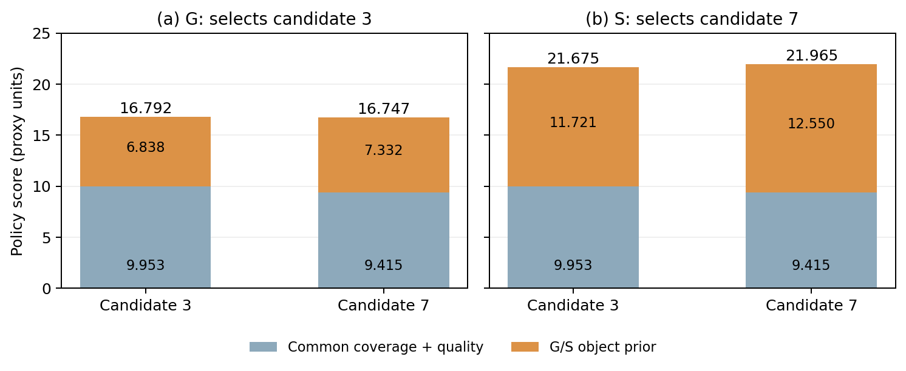

对168个已记录规划状态作事后标量等价审计，其中86个是S轨迹实访状态，82个是G实访状态上的S评分反事实。在一个状态——部署策略west/96的S轨迹第3次规划、已付费41动作——对于保存的候选集，任何非负统一几何先验权重均不能复现S所选目标；此时覆盖已达99.728%，不属于早期覆盖。该状态由审计后选择。

从完全相同的41动作S前缀出发，S、G和G×2分别续接一次并均完成返航；S完整复现原归档，G与G×2逐步一致。相对于G/G×2，S在切换后新增的参考可见表面多0.099926 m²，新增已观测面积少0.04 m²，路程少0.8 m，终点F1@5 cm低0.001203。这是后验选状态的晚期单例干预，终点结果混合，不能证明普遍或实车语义收益；双房间G×2完整复现S的负归因结果单独保留。这些续接不增加原24条矩阵样本数。

### 6 双房间受控机制诊断

另行构造一个Q0 shelf-west派生的双房间受控场景，沿用设备、传感配置、噪声种子和合成RGB标记语义，增加带1.6 m门洞的隔墙。最初门洞位置在几何预检中受阻，观察任何策略轨迹之前已调整；模拟器和评价器使用参考几何，策略仅接收虚拟RGB-D、扫描和准确模拟里程计。这两条轨迹与前述24条Q0矩阵分开报告，但同源相关，不是独立自然场景或实车证据。

**表4-4 双房间G/S及事后G×2结果和首次覆盖阈值。** 表面为相对首帧新增、由仿真参考计算的可见表面；F1阈值为5 cm。

| 方法 | 起始/终点覆盖 | 首达90/95/99%动作 | 新可见表面 m² | F1@5cm | 路程 m |
|---|---|---|---:|---:|---:|
| G | 60.12% / 99.01% | 22 / 26 / 58 | 123.97 | 0.9119 | 16.8 |
| S | 60.12% / 99.01% | 22 / 26 / 56 | 126.58 | 0.9221 | 16.4 |
| G×2（事后） | 60.12% / 99.01% | 22 / 26 / 56 | 126.58 | 0.9221 | 16.4 |

两者均在第19动作穿过门洞，执行96次付费动作、零模拟碰撞并返航，终点覆盖相同。第19个付费动作后的第二次规划，覆盖率为86.61%，共同历史、候选列表和审计哈希一致；G选择候选3，S选择候选7。G对候选3的领先分差为0.044313，S对候选7的领先分差为0.290468，均为严格领先而非同分规则。事后对同一候选集将几何先验按标量重加权，当λ > 1.08973877时也选择候选7；因此该单状态记录尚未区分语义类别相对重加权几何先验的独特优势，该标量审计本身只涉及单一状态。 在观察原G/S结果及标量审计后，另固定几何对象先验权重为2，事后执行一次96动作控制。其96步动作、位姿、观测哈希、覆盖及表面过程与S完全一致，13次规划目标及终点F1、表面面积和路程也相同。该控制不是前瞻独立基线；在本例中，几何先验重加权可复现S的完整差异，不能隔离类别信息特有收益。两候选共同覆盖与质量项分别为9.953、9.415，G对象先验项为6.838、7.332，S为11.721、12.550，先验条件下的排序发生反转（图4-2）。首次执行动作及表面差异均在第31动作，此时两者覆盖均为98.31%。终点差异包含后续完整轨迹，不能归因于单次动作；该结果支持合成标记条件下的评分机制，不证明跨场景泛化、自然语义或实车效率收益。

{width=600px}

图4-2 同一仿真观测状态下两个选中候选的评分组成；共同项与对象先验均为规划代理，并非重建质量或额外实测观测。参考场景仅用于模拟和评价。

