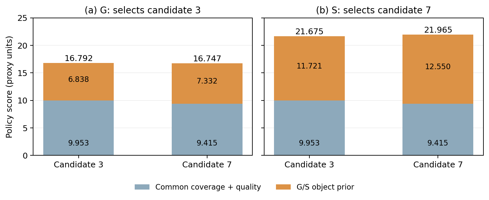

### 6.4 Q0-derived two-room mechanism diagnostic

We separately evaluated one controlled two-room construction derived from Q0 shelf-west. A divider with a 1.6 m opening was added to the same assets, sensor configuration, noise seed and synthetic RGB marker semantics. An initial doorway position was found blocked during geometry preflight and moved before any policy trajectory was observed. The simulator/reference geometry is used for rendering and evaluation, not supplied to the policy, which receives measured virtual RGB-D, scan and exact simulated odometry. These two trajectories are distinct from the preceding 24-run Q0 matrix, but are related to it and do not constitute independent natural scenes or physical evidence.

| Mode | Coverage at start / end | First 90 / 95 / 99% (action) | New visible surface (m²) | F1@5 cm | Path (m) |
|---|---|---|---:|---:|---:|
| G | 60.12% / 99.01% | 22 / 26 / 58 | 123.97 | 0.9119 | 16.8 |
| S | 60.12% / 99.01% | 22 / 26 / 56 | 126.58 | 0.9221 | 16.4 |
| G×2 (post hoc) | 60.12% / 99.01% | 22 / 26 / 56 | 126.58 | 0.9221 | 16.4 |

Both crossed the doorway at action 19, completed 96 paid actions, returned to the anchor and recorded zero simulated collisions. The final coverage was equal. At the second planning call after 19 actions, coverage was 86.61% and common history, candidate lists and audit hashes matched. G selected candidate 3 and S selected candidate 7: their common coverage-plus-quality scores were 9.953 and 9.415, while G prior contributions were 6.838 and 7.332 and S prior contributions were 11.721 and 12.550. Thus the prior-conditioned ranking reversed at this observed state (Figure 13). G selected candidate 3 over candidate 7 by 0.044313, while S selected candidate 7 over candidate 3 by 0.290468; both margins are strict rather than tie breaks. A post-hoc scalar reweighting of the geometric prior also selects candidate 7 when λ > 1.08973877 on this same candidate set, so this trace does not isolate a category-specific advantage over reweighting. This scalar audit alone is a single-state calculation. After observing the original G/S results and the scalar audit, one post-hoc control fixed the geometric-object prior weight to 2 and executed one 96-action run. Its 96 recorded actions, poses, observation hashes, coverage and surface progress match S exactly; all 13 planning targets and terminal F1, surface area and distance also match. This is not a prospective independent baseline; in this case the complete S difference is reproducible by geometric-prior weighting and does not isolate a category-specific benefit. The first executed action and surface difference occurred only at action 31, when both coverage values were 98.31%. The later endpoint differences describe complete trajectories, not the causal effect of one action. These observations support a synthetic-marker-conditioned scoring mechanism, not generalization, natural semantic benefit or real-robot efficiency.

Figure 13. Recorded simulator policy scores for the two selected candidates. Common terms and the respective G/S object priors are planning proxies; they are not measured reconstruction quality or additional observations. The reference scene is used only for simulation and evaluation.

