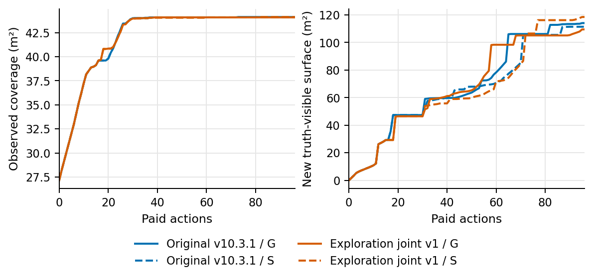

# 未知环境联合探索方法及实车验证（工作稿）

## 1 问题定义与系统数据流

面向未知大场景的主动覆盖探索需要在地图不完整时持续选择可执行的观察位置。本章以未知区域覆盖为主要目标，以已测表面的补充观察为联合目标：机器人依次获取激光扫描、RGB-D图像和位姿，在当前已知可行区域中规划，将执行后的新观测用于更新地图和下一次决策。与前述公开安全图、候选模板及准确位姿的受控设施建档任务不同，这里不预先提供全局安全姿态图；真实部署仍从初始观测开始，初始地图并非空白。两项任务的输入权限、方法版本和评价指标不同，其结果分别报告。

设时刻 \(t\) 的二维占据状态为 \(B_t(x)\in\{-1,0,1\}\)，分别表示未知、已知空闲和占据；\(M_t\) 为由已接受深度帧融合得到的表面地图，\(H_t\) 为实际相机位姿和观测历史。机器人状态为离散位置及朝向 \(s_t\)，初始返航锚点为 \(s_0\)，剩余动作预算为 \(b_t\)。候选宏动作 \(r\) 包含从当前状态到目标的去程和从目标返回锚点的返程。候选必须位于当前观测构成的安全图中，并满足去程与预留返程的动作代价之和不超过剩余预算。该约束依赖当前地图和圆形轮廓，不能解释为未知环境中的绝对安全保证。

数据流为：扫描与定位输入更新二维地图；RGB-D及对应位姿更新实测表面和相机观测历史；语义前端在实际图像上给出类别支持，结合测量点形成结构对象假设；规划器依据当前地图、历史、预算和候选轨迹计算覆盖与表面观察代理，选择下一宏动作；执行端逐步下发动作并检查实际反馈，再以新观测进入下一轮。TSDF只融合实际取得的深度，候选可见性和结构潜力是规划预测，不作为新观测或重建真值。ROS导航避障与硬件停止保护是执行层保护，研究策略中的已观测安全图和返航预算检查则属于决策过程；共同保护层本身不证明策略与其他版本等价。

## 2 联合候选与评分

原始 v10.3.1 CPU 实现采用基于已观测增益反馈的总量评分。对去程状态序列 \(r^{\rm out}\)，令 \(R_r,C_r\) 分别为预测的激光和相机增益掩码，\(a\) 为网格边长，\(\hat p_R,\hat p_C\) 为实际观测反馈更新的增益后验均值，\(Q_r\) 为已测表面质量增量代理。公共项可写为

\[
U_{\rm common}(r)=a^2\bigl(\hat p_R|R_r|+\hat p_C|C_r|\bigr)+Q_r .
\]

这里 \(Q_r\) 对应代码中由候选响应特征、已有质量点数、\(0.15^2\) 和去程动作代价计算的代理；它不是独立真值F1。返程用于可行性和预算核算，不被计入预期去程收益。预测与随后接受的观测相比较，反馈用于更新后验；预测未实现和预测外实现均应保留。选择时比较候选总评分，分数相同时按代价等既定规则打破平局，而不是把预测面积直接视为实际覆盖。

对已测结构对象 \(i\)，记测量宽、深、高为 \(w_i,d_i,h_i\)，类别投票为 \(v_i\)，是否具有标记测量支持为 \(m_i\in\{0,1\}\)。代码中的一般几何势与类别势分别为

\[
g_i=w_i h_i+3w_i d_i,\qquad
s_i=w_i h_i+3(1-v_i)w_i d_i.
\]

对象的候选因子 \(f_i(r)\) 来源于候选去程可见支持与历史观测；启用实测方向版本时，它取去程各状态的孔径支持均值与方向新颖度因子的乘积最大值，其中方向分为八扇区，新颖度下限为0.25。于是实际 G 和 S 两种评分为

\[
U_G(r)=U_{\rm common}(r)+\sum_i f_i(r)g_i,\qquad
U_S(r)=U_{\rm common}(r)+\sum_i f_i(r)[m_i s_i+(1-m_i)g_i].
\]

它们共享覆盖与质量项；S只对有标记支持的对象使用类别势。类别支持、候选中的有效可见方向以及对象因子同时具备时，类别项才可能改变排序。该公式是规划代理，不意味着类别识别正确，也不保证S优于G。完成动作后系统更新占据、表面与历史；若原宏动作因新地图失效，已授权部署变体重新规划。若当前轮廓或锚点在已观测图上不满足条件，则停止，不能将停止解释为成功返航。

## 3 实车部署与版本边界

实车采用基于 v10.3.1 的显式修订版本 exploration_joint_v1。它将相机增益限定到占据未知且未见、未尝试的格子，保留按空间分箱分散的覆盖候选，并在去程宏动作失效后重新规划；这些会改变候选或决策，必须作为部署变体报告。相机及激光的预测范围分别适配为4 m和8 m，也会影响排序。部署以0.2 m网格及半径约0.7212 m的原圆形轮廓构造安全图，保留ROS常规避障和硬件停止保护。该变体与原 v10.3.1 及前述V35公开姿态图机制均不是同一策略。

实车的数据来自真实RGB-D、激光扫描及底盘反馈。CSM激光里程计与gmapping提供定位建图，ROS承担导航执行，TSDF融合接受的深度，YOLOE-v8s-seg提供自然图像的语义支持。实车采用声明的 real_scene_structural_v1 类别映射：例如柜体或展示柜可对应闭合结构假设；这是部署先验，不能写成原始类别语义或独立验证的识别准确率。仿真使用自身虚拟传感、已知评价参考与原 v10.3.1，不能把其评分差异直接归因于实车部署。

## 4 首帧仿真与实车记录

表1汇总可直接追溯的结果。首帧仿真采用两个互换布置、两档预算和G/S，合计八条执行；两个布置是同一受控场景的互换，不是两个独立自然场景。起始二维覆盖率均为61.50%，因此这一组可观察从部分未知状态出发的变化。旧151帧共同前缀的初始二维覆盖已为100%，不用于证明未知空间探索。

| 证据 | 条件与独立单位 | 记录结果 | 可支持的范围 |
|---|---|---|---|
| 原v10.3.1首帧仿真 | 两个互换布置×48/96动作预算×G/S，共8条 | 48步两布置G/S均为89.86%；96步west G/S为99.91%/99.82%，east均为99.91% | 固定矩阵中的覆盖结果；west 96下S低于G，其余持平，不支持实车效益或跨场景泛化 |
| 部署策略首帧仿真 | exploration_joint_v1 策略，物理适配器关闭；同一Q0的两布置×48/96步×G/S，共8条 | 48步两布置G/S均为93.57%；96步west G/S为99.82%/99.91%，east均为99.82% | west 96下S高于G，其余持平；条件仿真，不是实车自然语义收益 |
| 实车完整闭环 | 一个部分已知现场，exploration_joint_v1，40付费动作，41帧含初始 | 40次到达并返航，CAN里程6.83485 m，耗时527.66 s；观测面积代理72.84增至120.00 m² | 单次集成及闭环可行性；面积为内部代理，非独立覆盖准确率 |
| 同状态评分审计 | 上述完整闭环的12次规划 | 所有同候选S与G得分相等，所选第一候选相同 | 该轨迹中未观察到评分差异；并非独立G轨迹比较 |
| 历史初始化后续 | 复用前述41帧，追加7动作，非独立重复 | 7次到达，1.11935 m、114.51 s，面积代理增加4.72 m²；未返航 | 延续记录及失败边界；前40动作成本单列，不能作为连续80动作原策略实验 |

两组矩阵均报告最终网格表面与固定仿真参考之间的双向距离F1；结果键 `f1_05cm` 中的“05cm”表示5 cm，即0.05 m，并非0.5 cm。表2列出全部配对的覆盖率与该F1。部署策略矩阵只替换策略，物理适配器关闭，其虚拟传感与受控语义条件不能证明真实YOLOE带来收益。部署策略在west、96步的S相对G的F1提高0.03731；其余三对相等。原版同条件S相对G降低0.02057，其余三对相等。两个布置和预算之间共享场景条件，这些差异是开发性结果，不能作为独立场景统计。

| 策略 | 布置 | 预算 | G覆盖率 / F1@5cm | S覆盖率 / F1@5cm |
|---|---|---:|---:|---:|
| 原v10.3.1 | west | 48 | 0.89855 / 0.88569 | 0.89855 / 0.88569 |
| 原v10.3.1 | west | 96 | 0.99909 / 0.96890 | 0.99819 / 0.94833 |
| 原v10.3.1 | east | 48 | 0.89855 / 0.88304 | 0.89855 / 0.88304 |
| 原v10.3.1 | east | 96 | 0.99909 / 0.98571 | 0.99909 / 0.98571 |
| 部署策略 | west | 48 | 0.93569 / 0.89094 | 0.93569 / 0.89094 |
| 部署策略 | west | 96 | 0.99819 / 0.94557 | 0.99909 / 0.98288 |
| 部署策略 | east | 48 | 0.93569 / 0.88832 | 0.93569 / 0.88832 |
| 部署策略 | east | 96 | 0.99819 / 0.96383 | 0.99819 / 0.96383 |

进一步以同一部署策略候选生成器构造覆盖评分消融C：C只按式中激光和相机的覆盖代理排序，不加入表面质量项和对象势；它不是标准frontier规划器，也不是独立外部基线。四条C结果如下。48步两布置的C、G、S覆盖和F1均相等；96步下C的F1分别为west 0.94256、east 0.95524，均低于相应G/S结果，覆盖率分别与G相等、与east的S相等。east的C在94步回到锚点后因无正收益候选停止，未耗尽96步上限；其余三条C及16条G/S均耗尽预算。20条均返航，模拟碰撞为零。这些是该受控矩阵内的评分消融，不能据此推断外部算法排名或实车效率。

| 布置 | 预算 / C实际步数 | C覆盖率 | C的F1@5cm |
|---|---:|---:|---:|
| west | 48 / 48 | 0.93569 | 0.89094 |
| west | 96 / 96 | 0.99819 | 0.94256 |
| east | 48 / 48 | 0.93569 | 0.88832 |
| east | 96 / 94 | 0.99819 | 0.95524 |

{width=560px height=216px}

图1 west布局96步受控仿真过程。左为已观测面积，右为相对首帧新增、以真值为参考的可见表面面积；横轴为付费动作。原版和部署策略的G/S分别绘制；图仅为一个Q0场景的两个版本结果，不包含C，不能解释为实车路径。两版本的S/G相对结果反转发生在该预算条件，不能由此推出普遍规律。

部署策略west 96的G/S在5 cm阈值下召回率为0.89716/0.96734，精确率为0.99950/0.99892；预测表面至参考的平均距离为0.00373/0.00431 m。F1差异主要对应召回变化，S的点级精确率略低且平均距离略大，不能据此声称点级精度提高。

实车完成轮次的机器人返回离散锚点，记录为预算耗尽后停止；此结果说明当前软硬件组合完成一次受限闭环，不构成覆盖效率优势。面积来自反馈中的已观测二维面积，受地图和观测条件影响；没有独立测量的场景面积或占据真值，不能据此计算真实覆盖率。12次规划的同状态S/G相等还说明，即便语义前端接入，当前记录未显示语义改变了这些候选的排序。

后续运行使用前一轮41帧实际观测作为初始化，但并未恢复原规划增益历史，因此既不是独立场景，也不是未经中断的原80动作策略。第7动作后新观测使当前圆形轮廓被判为不满足已知安全条件，运行停止而未返航。审计发现一个深度点落在冲突格，并对应画面中的黑色矩形物；其是否为外部物体或车体附件尚待现场确认。不能将其断言为噪声，也不能在身份未明时将其当作已知自车。离线对象支持分析属于诊断，不能代替重新执行的策略比较。

## 5 讨论与小结

本章给出了未知区域覆盖和已测表面观察共同参与候选选择的数据流，并保留了实际部署相对原实现的决策变化。原始与部署策略仿真矩阵提供受控首帧覆盖记录，实车记录提供单场景闭环与中止案例；二者均不能单独建立未知大场景的效率优势。后续应在相同初始信息、传感器、预算、返航契约与执行保护下，取得匹配实车覆盖基线及独立重复，分别报告时间、路程、覆盖增量、失败和返航；还需以可改变候选的自然语义条件检验语义决策作用，并以独立参考评价表面重建精度。在这些证据取得之前，面积代理、自然语义连接和运动完成分别描述观测、接口与执行，不能合并为语义增强带来高效精确重建的结论。
